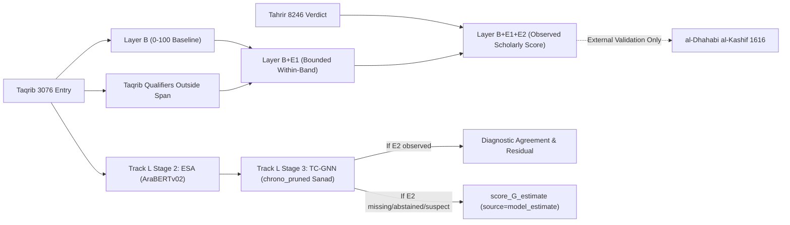

# A Multi-Modal Framework for Quantifying Narrator Reliability in *ʿIlm ar-Rijāl* Using Evaluative Stance and Graph Neural Networks

**Repository:** `alansyahmi/automated-rijal-framework-tc-gnn` (`taqrib-oriented-v2` / v3 layered architecture)

---

## 1. Two-Track Layered Architecture (0–100 Reliability Scale)

Each narrator in Ibn Ḥajar al-ʿAsqalānī's *Taqrīb al-Tahdhīb* (`8,827` entries; Book `3076`) is assigned an auditable `0–100` score across strictly separated **Representation (Track R)** and **Learning / Validation (Track L)** tracks:

| Track | Layer(s) | Learned? | Source & Rule |
|---|---|---|---|
| **Track R** | **B** (`score_B`) | Deterministic | Ibn Ḥajar's *Taqrīb* 12 *marātib* mapped onto the classical *ḥukm*-anchored `0–100` scale (`hukm_v1`: `100, 95, 85, 70, 45, 40, 35, 30, 27, 15, 5, 0`; thresholds `80 = ṣaḥīḥ`, `50 = accepted alone`, `25 = iʿtibār` via [common/rank_scale.py](file:///Users/Macomac/Projects/automated-rijal-framework-tc-gnn/common/rank_scale.py)), preserving `abstained` explicitly (`7,262` observed; `1,565` abstained). |
| **Track R** | **B + E₁** (`score_E1`) | Deterministic | Evidence-first within-band adjustments (`local_band_half_width` on `hukm_v1` preventing rank-midpoint or threshold crossings; `hafiz`/`faqih` retained as `0.0`-delta descriptive evidence per `DEC-011`; sensitivity presets `default`, `halved`, `doubled`, `off`). |
| **Track R** | **B + E₁ + E₂** (`score_E2`) | Deterministic | Editorial verdicts of *Taḥrīr Taqrīb al-Tahdhīb* (`8246`, al-Arnāʾūṭ & Maʿrūf): `4,177` agreements, `2,398` dissents (no implicit `E₁ → E₂` inheritance per `DEC-011`), `398` agreed *maqbūl* → rank 7 (`35.0`), `463` bare *ḍaʿīf* (`p. 47`, unusable for *iʿtibār*) = `22.0`, `211` first-time grades where *Taqrīb* abstained (`10` `missing`, `57` `suspect_alignment` excluded from evaluation). |
| **Track L** | **ESA + TC-GNN (`G`)** | Learned | Stage 2 **entry-level Evaluative Stance Analysis (ESA)** (predicting *Taḥrīr*'s ordinal verdict and 3-class shift from full *Taqrīb* entries, not quote/speaker extraction) feeds Stage 3 **TC-GNN (Text-Classification-informed GNN)** over the directed `chrono_pruned` *sanad* graph (`42,011 → 37,364` edges). **Never overwrites** observed *Taḥrīr* verdicts; emits diagnostics (`G_agrees_with_tahrir`, `G_residual`) when E₂ is observed and `score_G_estimate` (`source = model_estimate`) only when E₂ is missing/abstained/suspect. |



---

## 2. Quick-Start Reproduction Commands

```bash
# P2: Build deterministic layers (B, B+E1, B+E1+E2) + span provenance (CPU)
python dataset_discovery/target_feasibility/build_layered_scores_v3.py

# P3: Build independent external validation set from al-Dhahabi's al-Kashif (CPU)
python dataset_discovery/target_feasibility/build_kashif_validation_v1.py

# P4: Train Track L Stage 2 ESA & Stage 3 TC-GNN (CUDA GPU or macOS AMD Radeon MPS)
python experiments/run_stage2_esa_benchmarks_v3.py --device auto --allow-hf-download
python experiments/run_stage3_tc_gnn_benchmarks_v3.py --device auto

# Or run the full macOS AMD Radeon Pro 5500M (4 GB VRAM MPS) pipeline in one command:
#   pip install -r requirements-macos-mps.txt
python experiments/run_radeon_mps_pipeline.py

# P5 & P6: Run Experiments A-D, al-Kashif bootstrap, E1 sensitivity, homophily & showcases (CPU)
python experiments/run_layered_experiments_v3.py
python experiments/visualize_layered_showcases_v3.py

# Verification suite (CPU)
pytest -q -m "not gpu"
```

---

## 3. Repository Structure & Key Results

- [common/](file:///Users/Macomac/Projects/automated-rijal-framework-tc-gnn/common/hashing.py): Line-ending-normalized SHA-256 (`sha256_text_normalized`) and POSIX manifest path helpers.
- [dataset_discovery/target_feasibility/](file:///Users/Macomac/Projects/automated-rijal-framework-tc-gnn/dataset_discovery/target_feasibility/build_layered_scores_v3.py): Deterministic layer builder (`build_layered_scores_v3.py`, `layer_rules_v3.json`) and *al-Kāshif* extractor (`build_kashif_validation_v1.py`).
- [experiments/](file:///Users/Macomac/Projects/automated-rijal-framework-tc-gnn/experiments/run_layered_experiments_v3.py): `v3_common.py`, Stage 2 ESA (`run_stage2_esa_benchmarks_v3.py`), Stage 3 TC-GNN (`run_stage3_tc_gnn_benchmarks_v3.py`), unified Experiments A–D runner (`run_layered_experiments_v3.py`), and showcase plotter (`visualize_layered_showcases_v3.py`).
- [results/layered_experiments_v3_2026-11-21/](file:///Users/Macomac/Projects/automated-rijal-framework-tc-gnn/results/layered_experiments_v3_2026-11-21/LAYERED_EXPERIMENTS_REPORT_V3.md): Complete Track R + Track L Experiments A–D (Stage 2 on AMD Radeon Pro 5500M MPS; Stage 3 5-seed CPU run with `backend = mps_native`, verified bit-exact `max_abs_diff = 0.0`):
  - **Simple Baselines vs Stage 2 ESA (`N = 1,077` clean test):** A deterministic mode **Lookup-Table baseline** (`(rank_B, maqbul) -> train mode`) already achieves `Rank MAE = 0.6202` and `3T-Acc = 0.8171` (vs **Majority baseline** `MAE = 2.4689`, `3T-MF1 = 0.1927`, `ShiftMF1 = 0.2550`) because `62%` of entries are unchanged and `maqbūl -> 7` is systematic. Stage 2 **`AraBERTv02` ESA (`M3b`)** justifies neural stance modelling by leading on **editorial Shift Macro-F1** (`0.7262`, `ActiveMF1 = 0.6410`, `MAE = 0.6597`, `QWK = 0.8892`, `3T-MF1 = 0.7919`) ahead of generic-sentiment `M3a` (`ShiftMF1 = 0.6963`, `MAE = 0.7189`), the Lookup-Table (`ShiftMF1 = 0.6576`), and `M0_Identity` (`ShiftMF1 = 0.2550`). Name-stripped `M3c` achieves `MAE = 0.6485`, `BinAcc = 0.9053`, `3T-MF1 = 0.7997`, `ShiftMF1 = 0.7183`, and resolves **`observed_first_grade`** narrators where *Taqrīb* abstained (`N = 211`: `BinAcc = 0.6967`, `3T-MF1 = 0.3998`, `Exact = 0.1896` vs `0.4739` / `0.1607` / `0.0000` for Majority).
  - **Stage 3 TC-GNN (`G4a–G4d` CPU `mps_native`) — Heterophily Negative Result:** Pure-*sanad* graphs exhibit strong 12-rank heterophily (`class homophily = 0.0474`, `edge = 0.2725`). Consequently, multi-hop message passing in `G4a` (`MAE = 0.6760`, `ShiftMF1 = 0.7240`) does **not** beat the 1-hop structural-feature MLP `G2b` (`MAE = 0.6558`, `p = 0.000` worse MAE for `G4a`; `BinAcc = 0.9090` vs `G0` `0.8951`, `p = 0.031`; `ShiftMF1 = 0.7247`) or overall `G0` MAE (`0.6597`). However, `chrono_pruned` filtering (`42,011 → 37,364`) stabilizes shift prediction over unpruned `G4b` (`0.7240` vs `0.7156`), and adding consolidated edges (`G4d`) reaches the highest ensemble `QWK = 0.8925` (`p = 0.032` vs `G2b`), `ShiftMF1 = 0.7320` (`p = 0.293` vs `G2b`), and `R6 MAE = 1.4563`.
  - **External Validation vs *al-Kāshif* (`1616`):** After symmetric overlap deduplication, dropping low-precision `n2`/`n3_sigil_subset` links, and excluding *Taḥrīr* citations of al-Dhahabī (`paired_clean`, `N = 1,994`, majority floor `0.4829`), *Taqrīb* `B` (`3T-Acc = 0.6836`, `3T-MF1 = 0.6932`, `3T-QWK = 0.6796`, `5T-Spearman = 0.7248`) and *Taḥrīr* `E2` (`3T-Acc = 0.6690`, `p = 0.1220`; `3T-MF1 = 0.6510`; `3T-QWK = 0.6757`, `p = 0.6860`; `5T-Spearman = 0.7520`, `+0.0272`, `p = 0.0000`) both show substantial convergent validity well above the majority floor while `E2` improves 5-tier ordinal rank correlation. On **ungraded / missing-*Taḥrīr* narrators** (`source = model_estimate`), non-overwrite `G4a` achieves **`76.03%`** (`0.7603`) 3-tier agreement on non-Companion narrators (`N = 317`, vs `55.52%` majority floor, `QWK = 0.8024`), **`80.85%`** overall (`N = 402`, vs `64.93%` floor, `QWK = 0.8161`), and **`78.00%`** non-verbatim (`N = 300`, vs `59.33%` floor, `QWK = 0.8063`).
- [notes/](file:///Users/Macomac/Projects/automated-rijal-framework-tc-gnn/notes/THESIS_MAPPING.md): Thesis mapping (`THESIS_MAPPING.md`), Results & Discussion chapter draft (`RESULTS_AND_DISCUSSION_DRAFT.md`), methodology & viva defense (`METHODOLOGY_AND_VIVA_DEFENSE.md`), Stage 1–3 notes, and Bilgin (2026) comparison.
- [governance/](file:///Users/Macomac/Projects/automated-rijal-framework-tc-gnn/governance/DECISION_LOG.md) & [research_protocol/](file:///Users/Macomac/Projects/automated-rijal-framework-tc-gnn/research_protocol/RESEARCH_PROTOCOL.md): Decision log (`DEC-001`–`DEC-011`), changelog, protocol objectives, and simplified research charter ([simplified_research_direction.md](file:///Users/Macomac/Projects/automated-rijal-framework-tc-gnn/notes/simplified_research_direction.md)).

> Frozen historical snapshots remain untouched under git tags/branches `frozen-v1` (`7dd7a4d`) and `v2.0-taqrib-frozen` (`935bd09`).
