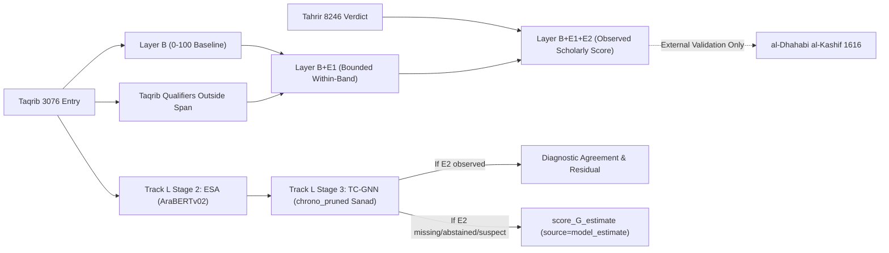

# A Multi-Modal Framework for Quantifying Narrator Reliability in *ʿIlm ar-Rijāl* Using Evaluative Stance and Graph Neural Networks

**Repository:** `alansyahmi/automated-rijal-framework-tc-gnn` (`taqrib-oriented-v2` / v3 layered architecture)

---

## 1. Two-Track Layered Architecture (0–100 Reliability Scale)

Each narrator in Ibn Ḥajar al-ʿAsqalānī's *Taqrīb al-Tahdhīb* (`8,827` entries; Book `3076`) is assigned an auditable `0–100` score across strictly separated **Representation (Track R)** and **Learning / Validation (Track L)** tracks:

| Track | Layer(s) | Learned? | Source & Rule |
|---|---|---|---|
| **Track R** | **B** (`score_B`) | Deterministic | Ibn Ḥajar's *Taqrīb* 12 *marātib* mapped onto `0–100` (`100 × (12 − r) / 11`), preserving `abstained` explicitly (`7,262` observed; `1,565` abstained). |
| **Track R** | **B + E₁** (`score_E1`) | Deterministic | Bounded within-band adjustments (`±1.0 × h`, where `h = 4.5455`) from explicit *Taqrīb* qualifiers outside the grade span (`231` adjusted; sensitivity presets `default`, `halved`, `doubled`, `off`). |
| **Track R** | **B + E₁ + E₂** (`score_E2`) | Deterministic | Editorial verdicts of *Taḥrīr Taqrīb al-Tahdhīb* (`8246`, al-Arnāʾūṭ & Maʿrūf): `4,177` agreements, `2,398` dissents, `398` agreed *maqbūl* → rank 7, `211` first-time grades where *Taqrīb* abstained (`10` `missing`, `57` `suspect_alignment` excluded from evaluation). |
| **Track L** | **ESA + TC-GNN (`G`)** | Learned | Stage 2 **Evaluative Stance Analysis (ESA)** out-of-fold features feed Stage 3 **TC-GNN (Text-Classification-informed GNN)** over the directed `chrono_pruned` *sanad* graph (`42,011 → 37,364` edges). **Never overwrites** observed *Taḥrīr* verdicts; emits diagnostics (`G_agrees_with_tahrir`, `G_residual`) when E₂ is observed and `score_G_estimate` (`source = model_estimate`) only when E₂ is missing/abstained/suspect. |



---

## 2. Quick-Start Reproduction Commands

```bash
# P2: Build deterministic layers (B, B+E1, B+E1+E2) + span provenance (CPU)
python dataset_discovery/target_feasibility/build_layered_scores_v3.py

# P3: Build independent external validation set from al-Dhahabi's al-Kashif (CPU)
python dataset_discovery/target_feasibility/build_kashif_validation_v1.py

# P4: Train Track L Stage 2 ESA & Stage 3 TC-GNN (CUDA GPU or macOS AMD Radeon MPS)
python experiments/run_stage2_esa_benchmarks_v3.py --device auto --allow-hf-download
python experiments/run_stage3_tc_gnn_benchmarks_v3.py --device auto

# Or run the full macOS AMD Radeon Pro 5500M (4 GB VRAM MPS) pipeline in one command:
#   pip install -r requirements-macos-mps.txt
python experiments/run_radeon_mps_pipeline.py

# P5 & P6: Run Experiments A-D, al-Kashif bootstrap, E1 sensitivity, homophily & showcases (CPU)
python experiments/run_layered_experiments_v3.py
python experiments/visualize_layered_showcases_v3.py

# Verification suite (CPU)
pytest -q -m "not gpu"
```

---

## 3. Repository Structure & Key Results

- [common/](file:///Users/Macomac/Projects/automated-rijal-framework-tc-gnn/common/hashing.py): Line-ending-normalized SHA-256 (`sha256_text_normalized`) and POSIX manifest path helpers.
- [dataset_discovery/target_feasibility/](file:///Users/Macomac/Projects/automated-rijal-framework-tc-gnn/dataset_discovery/target_feasibility/build_layered_scores_v3.py): Deterministic layer builder (`build_layered_scores_v3.py`, `layer_rules_v3.json`) and *al-Kāshif* extractor (`build_kashif_validation_v1.py`).
- [experiments/](file:///Users/Macomac/Projects/automated-rijal-framework-tc-gnn/experiments/run_layered_experiments_v3.py): `v3_common.py`, Stage 2 ESA (`run_stage2_esa_benchmarks_v3.py`), Stage 3 TC-GNN (`run_stage3_tc_gnn_benchmarks_v3.py`), unified Experiments A–D runner (`run_layered_experiments_v3.py`), and showcase plotter (`visualize_layered_showcases_v3.py`).
- [results/layered_experiments_v3_2026-11-21/](file:///Users/Macomac/Projects/automated-rijal-framework-tc-gnn/results/layered_experiments_v3_2026-11-21/LAYERED_EXPERIMENTS_REPORT_V3.md): Track R Experiments A–C, paired bootstrap on *al-Kāshif* (`+11.65 pp` 3-tier accuracy for E₂ over B on non-verbatim narrators, `N = 2,566`, `p < 0.001`), E₁ sensitivity (`default`/`halved`/`doubled`/`off`), pure-*sanad* homophily (`42,011 -> 37,364` `chrono_pruned`), and Gold-50 / Rank-6 showcases. *(Note: Stage 2/3 v3 Track L training awaits CUDA GPU execution on Alan's machine.)*
- [notes/](file:///Users/Macomac/Projects/automated-rijal-framework-tc-gnn/notes/THESIS_MAPPING.md): Thesis mapping (`THESIS_MAPPING.md`), methodology & viva defense (`METHODOLOGY_AND_VIVA_DEFENSE.md`), Stage 1–3 notes, and Bilgin (2026) comparison.
- [governance/](file:///Users/Macomac/Projects/automated-rijal-framework-tc-gnn/governance/DECISION_LOG.md) & [research_protocol/](file:///Users/Macomac/Projects/automated-rijal-framework-tc-gnn/research_protocol/RESEARCH_PROTOCOL.md): Decision log (`DEC-001`–`DEC-008`), changelog, protocol objectives, and v3 implementation plan.

> Frozen historical snapshots remain untouched under git tags/branches `frozen-v1` (`7dd7a4d`) and `v2.0-taqrib-frozen` (`935bd09`).
