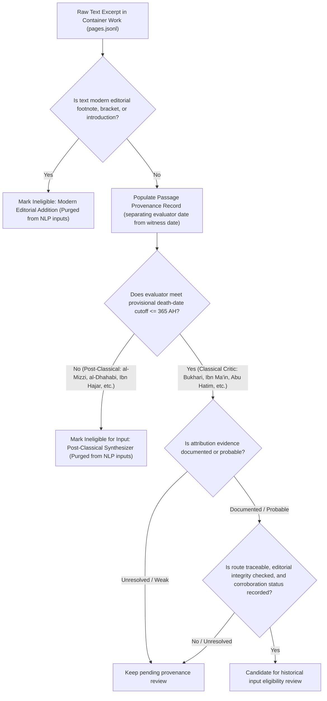

# Passage-Level Provenance and Temporal Firewall Specification

## 1. Research Purpose and Motivation

This specification defines the provenance, attribution, and temporal firewall protocol for the final year project:
**"A Multi-Modal Framework for Quantifying Narrator Reliability in ʿIlm ar-Rijāl Using Semantic Sentiment Analysis and Graph Neural Networks"**.

In hadith biographical literature (*kutub al-rijāl*), an evaluative entry is rarely a monolithic statement by a single author. Instead, biographical compendia function as multi-layered anthologies preserving oral interrogations (*suʾālāt*), written correspondence, transmitted isnads of criticism, personal scholarly syntheses, and centuries of subsequent marginalia.

Earlier iterations of our methodology relied upon a coarse, book-level temporal firewall:
\[ T_{\text{author\_death}} \le 365\text{ AH} \]
While conceptually intended to exclude post-classical compilers (such as al-Mizzī, al-Dhahabī, and Ibn Ḥajar), a book-level filter fails to protect research validity because:
1. **Modern Editorial Interventions**: Modern critical editions contain editor footnotes (`حاشية`), bracketed emendations, variant apparatus, and biographical essays (e.g., by Dr. Bashshār ʿAwwād Maʿrūf or Shaykh Shuʿayb al-Arnāʾūṭ) that postdate classical criticism by over a millennium. Treating edited text as homogeneous historical data risks training machine-learning models on 20th-century editorial judgments.
2. **Quoted Later Authorities**: Earlier compendia may contain marginal notes, student interpolations, or citations added during textual transmission that postdate the titular author.
3. **Multi-Voiced Entries**: A single entry in an 8th-century work like *Tahdhīb al-Kamāl* (al-Mizzī, d. 742 AH) often cites 2nd-century critics verbatim (e.g., Yaḥyā b. Maʿīn, d. 233 AH). If filtered strictly at the book level, valid early historical evidence is discarded; if accepted uncritically at the book level, 8th-century compiler judgments leak into the input features.

Therefore, we establish a **passage-level provenance protocol**. Every candidate text excerpt considered for NLP feature extraction or target audit must be individually evaluated and verified.

---

## 2. Passage-Level Provenance Schema

Every extracted textual unit must be annotated according to the following provenance schema:

| # | Field Name | Type | Allowed Values / Format | Description |
| :-: | :--- | :--- | :--- | :--- |
| 1 | `source_work_id` | Integer | Valid Shamela/HF Book ID (e.g., `1615`, `1716`, `3076`) | Numeric identifier of the container work. |
| 2 | `source_work_title` | String | Canonical Arabic title | Standardized title of the container work. |
| 3 | `source_work_author` | String | Canonical work author/compiler | The author or compiler of the work preserving the report (e.g., Ibn Abī Ḥātim, al-Mizzī). |
| 4 | `source_work_date` | String | Composition/compilation date or `unresolved` | Approximate date the source work was composed or compiled. This is not the date of the surviving copy. |
| 5 | `source_edition` | String | Free-text bibliographic metadata | Editor, publisher, publication date, and print volume/part. |
| 6 | `source_page_or_entry` | String | E.g., `Vol. 2, p. 154, Entry #1240` | Precise physical page and entry locator within the printed edition. |
| 7 | `passage_verbatim` | String | Full Arabic text string | The complete, unedited text of the passage exactly as recorded. |
| 8 | `attributed_evaluator` | String | Canonical scholar name or `unresolved` | The primary historical critic to whom the judgment is attributed (e.g., `يحيى بن معين`, `أحمد بن حنبل`). |
| 9 | `historical_evaluator_date` | String | Death date in AH (e.g., `233 AH`, `241 AH`) or `unresolved` | Death date or documented floruit of the attributed historical critic. |
| 10 | `reporting_authority` | String | Canonical scholar name, `direct_author`, or `unresolved` | The intermediate student or transmitter reporting the evaluation (e.g., `عباس الدوري`, `عبد الله بن أحمد بن حنبل`). |
| 11 | `textual_speaker` | String | `primary_critic`, `transmitting_author`, `compiling_editor`, `modern_editor` | The immediate voice uttering the specific sentence. |
| 12 | `attribution_evidence` | String | `explicit_hearing_formula`, `transmitted_isnad`, `written_compilation`, `passive_attribution`, `editorial_footnote` | The textual mechanism establishing attribution. |
| 13 | `editorial_material_status` | String | `author_body_text`, `editor_footnote`, `editor_bracketed_addition`, `variant_reading_note`, `transmission_gloss` | Structural status of the passage within the printed edition. |
| 14 | `input_eligibility` | String | `eligible`, `ineligible`, `quarantined_pending_verification` | Determination for NLP training input feature inclusion. |
| 15 | `eligibility_reason` | String | Structured explanation | Justification for input eligibility determination. |
| 16 | `verification_status` | String | `documented`, `probable`, `possible`, `unverified` | Degree of empirical verification for the attribution. |
| 17 | `approximate_judgment_date` | String | Date/range or `unresolved` | Approximate date the specific judgment was made, only if evidence supports it. |
| 18 | `surviving_witness_date` | String | Date/range or `unresolved` | Date of the manuscript or textual witness actually consulted. Do not infer from source-work composition. |
| 19 | `corroboration_status` | String | `independent_corroboration`, `dependent_corroboration`, `unresolved_corroboration` | Whether support comes from a separate route, depends on an earlier source, or cannot be resolved. |

### Separate the Relevant Dates

Do not conflate these five dates:

- **Critic lifespan and death** (`historical_evaluator_date`): the known lifespan, death date, or documented period of the attributed critic. It constrains the possible date of an utterance but does not date a particular judgment.
- **Approximate judgment date**: when a specific judgment was made, if evidence supports an estimate. Do not infer this date from the critic's death date.
- **Source-work composition date** (`source_work_date`): when the work preserving the report was composed or compiled. It is not the date of a surviving copy.
- **Surviving manuscript or textual-witness date**: the date of the physical or textual witness actually consulted. A later witness may preserve earlier material; assess the transmission path and uncertainty. Do not infer this date from work composition.
- **Modern editor and edition date** (`source_edition`): the editor, publication, and edition consulted. A modern edition is not itself an early manuscript witness.

For example, an attributed statement by Aḥmad b. Ḥanbal (d. 241 AH) in a work compiled by al-Mizzī (d. 742 AH) may be considered under the project's provisional `T <= 365 AH` operational rule if attribution and transmission are verified. This does not date the individual judgment, nor does al-Mizzī's work date establish the age of the copy consulted.

### Corroboration Status

Use one of these values when recording corroboration:

- `independent_corroboration`: a separately traceable source or transmission route supports the passage.
- `dependent_corroboration`: a later compilation reproduces an earlier source or compilation; this is not independent confirmation.
- `unresolved_corroboration`: source dependence cannot be established.

Multiple compilations alone do not demonstrate independent corroboration. A manuscript physically dated before 365 AH is not an absolute eligibility requirement; assess surviving evidence and record uncertainty.

## 3. Strict Rules for Attribution and Input Eligibility

### Rule 1: Exclusion of Modern Editorial Commentary
Any text classified as `editor_footnote`, `editor_bracketed_addition`, or modern introduction is categorically **ineligible** for NLP feature extraction.
- *Rationale*: Modern editorial notes (such as Dr. Bashshār ʿAwwād's commentary in *Tahdhīb al-Kamāl* or *Taḥrīr Taqrīb*) represent 20th-century scholarly analysis. Feeding modern critical summaries into models intended to reproduce classical assessments constitutes catastrophic methodological leakage.

### Rule 2: Provisional Temporal Input Rule
To enter the model's input feature vector:
1. For this project's provisional operational rule, the `attributed_evaluator` death date is at or before **365 AH**. This cutoff requires historical justification and does not establish when a particular judgment was made.
2. The `attribution_evidence` must be verified as `documented` or `probable`.
3. If an evaluation cannot be securely attributed to an early classical authority, its `input_eligibility` must be marked `ineligible` or `quarantined_pending_verification`.
4. Ambiguities must be preserved as `unresolved` rather than forced into early critic attributions.

### Rule 3: Distinguishing Levels of Source Dependence
Researchers must not conflate general intellectual influence with passage-level textual dependence:
- **Work-Level Intellectual Relationship**: A general scholarly tradition wherein later authors consult earlier works (e.g., Ibn Ḥajar consulting al-Mizzī). Marked as `documented` at the macro-bibliographical level, but does not prove any specific sentence was quoted verbatim.
- **Passage-Level Textual Correspondence**: Direct textual parallel between two specific entries across editions. Marked as `documented` only when verbatim phrasing and isnad structures coincide.
- **Attribution of a Specific Historical Judgment**: Identification of the exact historical speaker who uttered an evaluative term (e.g., Abū Ḥātim al-Rāzī saying "Ṣadūq").

All dependency claims must carry an explicit epistemic status:
- `documented`: Supported by explicit textual citation, verified isnad, or exact parallel passage.
- `probable`: Supported by strong contextual evidence and consistent scholarly attribution, without verbatim quotation marks.
- `possible`: Plausible attribution based on shared vocabulary or contemporary overlap, but lacking direct textual evidence.
- `unverified`: Conjectured connection without empirical passage-level proof.

---

## 4. Epistemological Stance: Ibn Ḥajar's Synthesis as Reference Target

### The Clarification of the Research Question
A core epistemological error is to frame the prediction target as "objective narrator reliability" or "historical consensus":
- **Ibn Ḥajar's Assessment is Not Historical Consensus**: The grades in *Taqrīb al-Tahdhīb* (Book ID 3076) represent Ibn Ḥajar's individual scholarly synthesis (*ijtihād*), formed in the 9th century AH (completed 827 AH). Earlier critics frequently disagreed on the same narrator (e.g., Yaḥyā b. Maʿīn declaring a narrator weak while al-ʿIjlī declares him trustworthy). Ibn Ḥajar weighed these conflicting testimonies to formulate a concise summary grade.
- **Scientific Definition of the Target**: The prediction target is defined as:
  > **"Ibn Ḥajar's standardized scholarly assessment, used as a reference target for computational emulation."**
- **The Valid Computational Task**: We investigate whether natural language processing models (lexical vs semantic) trained on fragmentary 2nd to 4th-century critic statements can reproduce Ibn Ḥajar's expert aggregation function without data leakage.
- **The Role of al-Dhahabī's al-Kāshif**: Al-Dhahabī died in 748 AH. *Al-Kāshif* (Book ID 1616) represents an **earlier biographical synthesis and abridgement, drawing substantially on al-Mizzī's *Tahdhīb al-Kamāl***, rather than an independent source or a later reassessment of *Taqrīb*. It serves as an earlier comparative benchmark (`الرتبة عند الذهبي`).
- **The Role of Later Critical Reassessments**: *Taḥrīr Taqrīb al-Tahdhīb* (Book ID 8246, al-Arnāʾūṭ & Maʿrūf) is a modern critical audit. It helps us identify narrators where classical consensus was divided, allowing error analysis to distinguish model failure from genuine historical ambiguity.

---

## 5. Ibn Ḥajar's 12-Rank Classification System

In the introduction to *Taqrīb al-Tahdhīb* (preserved in the Muḥammad ʿAwwāmah edition and confirmed in *Taḥrīr Taqrīb*, Vol. 1, pp. 51-53), Ibn Ḥajar explicitly establishes twelve distinct narrator ranks (*marātib al-jarḥ wa-al-taʿdīl*). These evaluative ranks are distinct from his twelve chronological generational cohorts (*al-ṭabaqāt al-zamaniyyah*).

To prevent loss of critical evaluative precision, **we strictly forbid premature collapse of these twelve ranks into a naive 3-class target** (`Thiqah`, `Ṣadūq`, `Below Ṣadūq`) without documented mapping and empirical justification.

The twelve authentic ranks, defined in Ibn Ḥajar's own words, are:

| Rank # | Ibn Ḥajar's Exact Arabic Definition | Primary Signaling Terms | Epistemic Category & Scholarly Significance |
| :-: | :--- | :--- | :--- |
| **1** | فأولها: الصحابةُ، فأصرِّح بذلك لشرفهم. | الصحابة (صحابي) | The Companions; stated explicitly due to their status and honor in the transmission hierarchy. |
| **2** | الثانية: منْ أكّدَ مدحه، إما بأفْعل كأوثق الناس، أو بتكرير الصفة لفظًا كثقة ثقة، أو معنى كثقة حافظ. | أوثق الناس، ثقة ثقة، ثقة ثبت، ثقة حافظ | Confirmed / emphasized reliability; superlative forms or repetition of praise attributes. |
| **3** | الثالثة: من أُفرِدَ بصفة: كثقة، أو متقن، أو ثَبْت، أو عَدْل. | ثقة، متقن، ثبت، عدل | Single-attribute high reliability; standard benchmark for Sahih transmissions. |
| **4** | الرابعة: من قَصُرَ عن درجة الثالثة قليلًا، وإليه الإشارة: بصَدُوق، أو لا بأس به، أو ليس به بأس. | صدوق، لا بأس به، ليس به بأس | Intermediate reliability; slightly below third rank; benchmark for Hasan transmissions. |
| **5** | الخامسة: من قَصُرَ عن الرابعة قليلا، وإليه الإشارة: بصَدُوق سيء الحفظ، أو صدوق يَهِم، أو له أوهام، أو يُخطِئ، أو تَغيَّر بأخَرةٍ. ويلتحقُ بذلك من رُمِي بنوع من البدعة. | صدوق سيئ الحفظ، صدوق يهم، له أوهام، يخطئ، تغير بأخرة | Truthful with explicit qualification regarding memory, errors, or ideological leanings; requires corroboration. |
| **6** | السادسة: مَن ليس له من الحديث إلا القليل، ولم يثْبُت فيه ما يُترك حديثه من أجله، وإليه الإشارة بلفظ: مقبول، حيث يتابع، وإلا فَليِّنُ الحديث. | مقبول (حيث يتابع)، لين الحديث (حيث ينفرد) | Minimal transmission volume; conditional grade accepted only when corroborated, otherwise *layyin al-ḥadīth*. |
| **7** | السابعة: مَن رَوَى عنه أكثرُ من واحد ولم يُوثّقْ، وإليه الإشارة بلفظ: مستور، أو مجهول الحال. | مستور، مجهول الحال | Multiple transmitters report from him, but internal accuracy unauthenticated by recognized critics. |
| **8** | الثامنة: مَن لم يوجد فيه توثيق لمعتبر، ووُجد فيه إطلاق الضعف، ولو لم يُفسرْ، وإليه الإشارة بلفظ: ضعيف. | ضعيف | Transmitters lacking authentication from recognized authorities, with unelaborated declaration of weakness. |
| **9** | التاسعة: مَن لم يَرْو عنه غيرُ واحد، ولم يُوثق، وإليه الإشارة بلفظ: مجهول. | مجهول | Solitary transmission: only one narrator reports from him, without authentication. Distinct from weakness. |
| **10** | العاشرة: من لم يوَثق البتة، وضُعِّف مع ذلك بقادحٍ، وإليه الإشارةُ: بمتروك، أو متروك الحديث، أو واهي الحديث، أو ساقط. | متروك، متروك الحديث، واهي الحديث، ساقط | Discarded transmitters; completely unauthenticated and impaired by disparaging defects. |
| **11** | الحادية عشرةَ: مَن اتُّهم بالكذب. | متهم بالكذب، يسرق الحديث | Transmitters accused of fabrication or lying. |
| **12** | الثانية عشرةَ: من أُطلِق عليه اسمُ الكذب، والوضع. | كذاب، وضاع | Proven liars and fabricators; deliberate false attribution. |

### Critical Observations on the Twelve Ranks
1. **Rank 1 Restraint**: Rank 1 identifies Companions explicitly (`فأصرِّح بذلك لشرفهم`). It is a status designation in the biographical schema rather than an ordinary product of empirical *jarḥ wa-taʿdīl*.
2. **Conditional Meaning of *Maqbūl* (Rank 6)**: Ibn Ḥajar's term `مقبول` is strictly conditional: *ḥaythu yutābaʿ wa-illā fa-layyin al-ḥadīth* (acceptable where corroborated; otherwise light/lenient in hadith). It must not be treated as an unconditional declaration of reliability.
3. **Strict Distinction Between Rank 8 (`ضعيف`) and Rank 9 (`مجهول`)**:
   - Rank 8 (*ḍaʿīf*) denotes a narrator who lacks authentication and has an unelaborated judgment of weakness.
   - Rank 9 (*majhūl*) denotes a solitary transmitter (*lam yarwi ʿanhu ghayru wāḥid*) without authentication.
   - Weakness and anonymity are distinct critical concepts in hadith methodology and must never be conflated.
4. **Rank 10 as Discarded / Abandoned**: Narrators designated as *matrūk*, *matrūk al-ḥadīth*, *wāhī al-ḥadīth*, or *sāqiṭ* represent a distinct, severe level of disparagement below ordinary weakness and anonymity.
5. **Rank 11 vs. Rank 12**: Rank 11 applies to those accused of lying (*man uttuhima bi-al-kadhib*); Rank 12 applies to those definitively labeled as liars or fabricators (*kadhdhāb*, *waḍḍāʿ*).

### Requirements for Target Representation
During the 60-record grade audit and subsequent feature extraction, researchers must preserve:
1. `original_entry_text`: Complete Arabic entry string from *Taqrīb*.
2. `original_grade_wording`: Exact evaluative phrase as written by Ibn Ḥajar (e.g., `ثقة ثبت`, `صدوق يهم`, `مقبول`).
3. `rank_number_1_to_12`: Explicit rank identifier (1 to 12) mapped strictly according to Ibn Ḥajar's criteria above, or `unresolved` if phrasing is ambiguous.
4. `qualifications_and_hedging`: Any explicit qualifiers regarding memory, sectarian leaning, or chronological alteration (e.g., `رمي بالتشيع`, `اختلط بآخره`, `يخطئ في الشاميين`).
5. `entry_num` and `page_num`: Printed locators in the Muḥammad ʿAwwāmah edition.

---

## 6. Audit of Previous Numerical Claims

The following empirical figures appeared in earlier experimental reports on `main` and must be transparently audited:

1. **"75.63% agreement" and "58 consensus divergences"**:
   - *Provenance*: These figures originated in an earlier preliminary sample audit of 238 shared scholars between Ibn Ḥajar's *Taqrīb* and al-Dhahabī's *al-Kāshif* ($180 / 238 = 75.63\%$).
   - *Audit Status*: **Unverified within the current reference corpus**. The 238-record sample is not part of the active branch's frozen empirical pipeline, nor has it been verified against the newly downloaded full texts of Books 3076 and 1616.
   - *Methodological Action*: These numbers are strictly removed from the reference corpus inventory. Any agreement rates between Ibn Ḥajar and al-Dhahabī must be calculated from a documented, reproducible script on the audited corpus.
2. **"p = 0.0215"**:
   - *Provenance*: This value was the two-tailed paired t-test result from the PO2 13-arm ablation comparing Early Fusion MLP (0.4810 Macro-F1) vs GCN Concat (0.4311 Macro-F1) across 25 CV folds.
   - *Audit Status*: While mathematically documented in the canonical thesis benchmark for PO2, it belongs to the graph message-passing ablation on transmission networks, **not** to the reference corpus text inventory.
   - *Methodological Action*: Removed from `RIJAL_REFERENCE_CORPUS_INVENTORY.md` to prevent confusing downstream modeling results with corpus establishment metrics.

---

## 7. Operational Workflow for Passage Extraction

This workflow is intended to document provenance decisions and preserve unresolved evidence. It cannot guarantee an unbroken provenance trail; eligibility remains a reviewed and revisable research decision.
