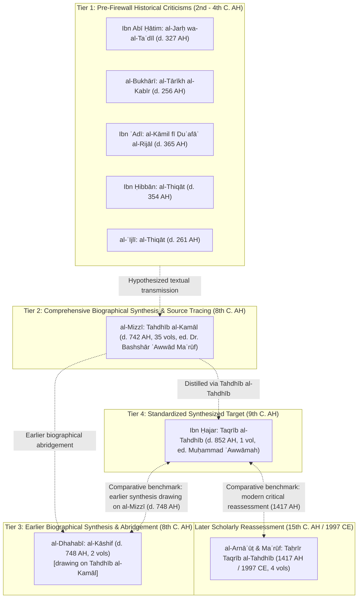
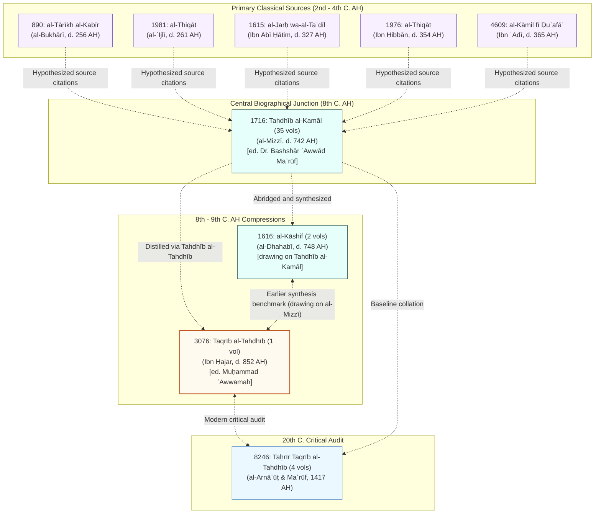

# Shamela4 Rijāl Reference Corpus Inventory & Provenance Audit

**Audit Execution Timestamp:** 2026-11-11 09:16:00 UTC  
**Upstream Source Repository:** [`AuthenticIlm/Shamela4_Full_DB`](https://huggingface.co/datasets/AuthenticIlm/Shamela4_Full_DB)  
**Local Storage Directory:** `data/1_raw/Shamela4_Full_DB/26__التراجم-والطبقات/` (Immutable raw storage; excluded from Git tracking)  
**Provenance & Firewall Specification:** [`PROVENANCE_AND_TEMPORAL_FIREWALL_SPEC.md`](file:///c:/Projects/automated-rijal-framework-tc-gnn/dataset_discovery/target_feasibility/PROVENANCE_AND_TEMPORAL_FIREWALL_SPEC.md)  

---

## 1. Executive Summary & 5-Tier Epistemic Architecture

This inventory establishes the local reference corpus of nine classical and post-classical *rijāl* works downloaded from `AuthenticIlm/Shamela4_Full_DB`. Rather than treating all biographical texts as a flat, homogeneous ground truth, the corpus is organized into a 5-tier chronological and epistemic architecture. Directional relationships represent research hypotheses of general intellectual lineage, not verified passage-level derivation:

### Key Epistemological Clarifications for the FYP
1. **Ibn Ḥajar's Assessment is Not Historical Consensus**: *Taqrīb al-Tahdhīb* (Book ID 3076) represents Ibn Ḥajar's standardized scholarly assessment, used as a reference target for computational emulation. It is not an automatically established consensus of earlier critics. The prediction task is modeling and emulating Ibn Ḥajar's expert assessment function from early historical statements, not discovering an objective historical reliability score.
2. **Chronological Position and Lineage of al-Dhahabī**: Al-Dhahabī died in 748 AH, more than a century before Ibn Ḥajar (d. 852 AH). *Al-Kāshif* (Book ID 1616) represents an earlier biographical synthesis and abridgement, drawing substantially on al-Mizzī's *Tahdhīb al-Kamāl*, rather than an independent source or a later reassessment of *Taqrīb*. It serves as an earlier comparative benchmark (`الرتبة عند الذهبي`).
3. **Al-Mizzī vs Modern Editor**: *Tahdhīb al-Kamāl* is authored by al-Mizzī (d. 742 AH); Dr. Bashshār ʿAwwād Maʿrūf is its 20th-century critical editor. Modern editorial footnotes, brackets, and commentary must never be conflated with classical text.
4. **Status of Taḥrīr Taqrīb**: *Taḥrīr Taqrīb al-Tahdhīb* (Book ID 8246) is a modern critical reassessment (1417 AH / 1997 CE) co-authored by Shaykh Shuʿayb al-Arnāʾūṭ and Dr. Bashshār ʿAwwād Maʿrūf, not an independent classical source. It serves to identify contested scholarly edge cases, and its judgments must not be merged into training labels.
5. **Passage-Level Provenance Required**: General intellectual dependence between works must not be presented as verified passage-level textual dependence. Every candidate input passage must be audited individually under the 14-field provenance schema in `PROVENANCE_AND_TEMPORAL_FIREWALL_SPEC.md`.

---

## 2. Comprehensive Inventory of Downloaded Works

| Book ID | Tier | Canonical Title | Primary Authority | Death | Research Role | Pages | Size (MB) | Editor / Edition Details |
| :---: | :---: | :--- | :--- | :---: | :--- | :---: | :---: | :--- |
| `3076` | Tier 4 | **تقريب التهذيب** | ابن حجر العسقلاني | 852 AH | `candidate_reference_target` | 688 | 1.99 MB | محمد عوامة (دار الرشيد - سوريا) |
| `8246` | Tier 5 | **تحرير تقريب التهذيب** | شعيب الأرنؤوط وبشار عواد معروف | 1438 AH | `later_scholarly_reassessment` | 1754 | 3.74 MB | مؤسسة الرسالة للطباعة والنشر والتوزيع، بيروت  |
| `1716` | Tier 2 | **تهذيب الكمال في أسماء الرجال** | يوسف بن عبد الرحمن المزي | 742 AH | `biographical_synthesis_and_source_tracing` | 19002 | 47.01 MB | مؤسسة الرسالة - بيروت |
| `1615` | Tier 1 | **الجرح والتعديل** | ابن أبي حاتم الرازي | 327 AH | `earlier_historical_criticism` | 4229 | 9.87 MB | مطبعة مجلس دائرة المعارف العثمانية، بحيدر آبا |
| `890` | Tier 1 | **التاريخ الكبير** | محمد بن إسماعيل البخاري | 256 AH | `earlier_historical_criticism` | 3785 | 11.04 MB | غير منصوص عليه صراحة |
| `4609` | Tier 1 | **الكامل في ضعفاء الرجال** | ابن عدي الجرجاني | 365 AH | `earlier_historical_criticism` | 4518 | 11.50 MB | عادل أحمد عبد الموجود-علي محمد معوض (الكتب ال |
| `1976` | Tier 1 | **الثقات** | محمد بن حبان البستي | 354 AH | `earlier_historical_criticism` | 4103 | 6.43 MB | دائرة المعارف العثمانية بحيدر آباد الدكن الهن |
| `1981` | Tier 1 | **الثقات (تاريخ الثقات)** | أحمد بن عبد الله العجلي | 261 AH | `earlier_historical_criticism` | 765 | 0.65 MB | عبد العليم عبد العظيم البستوي (مكتبة الدار -  |
| `1616` | Tier 3 | **الكاشف في معرفة من له رواية في الكتب الستة** | شمس الدين الذهبي | 748 AH | `earlier_synthesis_and_abridgement` | 1218 | 2.19 MB | محمد عوامة أحمد محمد نمر الخطيب (دار القبلة ل |

---

## 3. The Dr. Bashshār ʿAwwād Maʿrūf Editorial Connection

Dr. Bashshār ʿAwwād Maʿrūf (b. 1940 CE) occupies a central dual role across this reference corpus. Distinguishing his modern editorial scholarship from classical authorial text is essential to preserving the temporal firewall and preventing methodological leakage:

### 1. Editor of *Tahdhīb al-Kamāl fī Asmāʾ al-Rijāl* (Book ID 1716)
- **Work**: 35-volume monumental edition published by Muʾassasat al-Risālah (Beirut, 1980 - 1992 CE).
- **Role**: Critical editor and textual investigator (*muḥaqqiq*).
- **Scholarly Contribution**: Over twelve years, Dr. Bashshār collated dozens of primary manuscripts across Damascus, Cairo, Istanbul, and Rabat. He identified obscure narrators, corrected corrupt transmission chains, verified biographical cross-references across classical works, and added comprehensive footnotes citing primary sources.
- **Methodological Rule**: Al-Mizzī (d. 742 AH) is the classical compiler of *Tahdhīb al-Kamāl*; Dr. Bashshār ʿAwwād Maʿrūf is its 20th-century editor. In the raw JSONL records, editorial footnotes (`حاشية`), editor brackets, and introduction essays belong to the modern editor and must **never** be attributed to al-Mizzī or injected into classical NLP feature extraction.

### 2. Co-Author of *Taḥrīr Taqrīb al-Tahdhīb* (Book ID 8246)
- **Work**: 4-volume critical re-examination of Ibn Ḥajar's *Taqrīb*, published by Muʾassasat al-Risālah (1417 AH / 1997 CE) co-authored with Shaykh Shuʿayb al-Arnāʾūṭ (d. 1438 AH).
- **Role**: Co-investigator and critical reassessor.
- **Scholarly Contribution**: In this work, Dr. Bashshār and Shaykh Shuʿayb systematic audit every single one of Ibn Ḥajar's 8,826 entries. For each narrator, they examine whether Ibn Ḥajar's summary grade accurately reflects the detailed evidence compiled in al-Mizzī's *Tahdhīb al-Kamāl* and early 2nd-4th C. AH sources, explicitly recording agreement (`وافقناه`) or dissent (`خالفناه`) with reasoned justifications.
- **Methodological Rule**: *Taḥrīr Taqrīb al-Tahdhīb* represents a 15th-century AH critical audit. It must never serve as ground-truth training labels. Instead, it serves as an external evaluation benchmark to identify controversial or boundary narrators where classical consensus was divided.

---

## 4. Source-Dependence & Provenance Map

In computational *ʿilm al-rijāl*, assuming that every statement in a later compilation directly quotes a specific earlier work without textual proof introduces severe errors. We distinguish three levels of relationship:
1. **Work-level intellectual relationship**: General historical influence and consultation of earlier literature.
2. **Passage-level textual correspondence**: Demonstrated verbatim or near-verbatim sharing of text.
3. **Attribution of a specific historical judgment**: Identifying the historical scholar who actually made the evaluative appraisal.

### Textual Authority Citation Matrix with Epistemic Status

| Book ID & Title | Upstream Sources Consulted | Method of Transmission | Epistemic Status of Relationship |
| :--- | :--- | :--- | :--- |
| **890: al-Tārīkh al-Kabīr** (256 AH) | Primary isnads and oral statements of early Medina/Basra/Kufa authorities | Firsthand transmission records | `documented` for its own text; `probable` when cited by later authors. |
| **1981: al-Thiqāt** (261 AH) | Oral evaluations of Kufan and Iraqi narrators | Dictated compilation | `documented` within compilation; `probable` when cited in *Tahdhīb*. |
| **1615: al-Jarḥ wa-al-Taʿdīl** (327 AH) | Abū Ḥātim al-Rāzī, Abū Zurʿah al-Rāzī, Yaḥyā b. Maʿīn, Aḥmad b. Ḥanbal | Verbatim interrogations (*suʾālāt*) | `documented` for interrogations; `probable` for transmitted chains. |
| **1976: al-Thiqāt** (354 AH) | Ibn Ḥibbān's criteria on reliable transmitters | Systematic compilation | `documented` within compilation; `probable` when referenced by al-Mizzī. |
| **4609: al-Kāmil fī Ḍuʿafāʾ** (365 AH) | Verbatim statements of Yaḥyā b. Maʿīn, al-Bukhārī, al-Nasāʾī, al-Sājī | Exhaustive critical dictionary | `documented` for cited statements; `probable` for al-Mizzī's quotes. |
| **1716: Tahdhīb al-Kamāl** (742 AH) | Classical works above plus over 100 early manuscripts | Monumental comprehensive compilation | `documented` as general intellectual baseline; passage-level links remain `probable` or `possible` pending verification. |
| **1616: al-Kāshif** (748 AH) | Earlier biographical synthesis and abridgement drawing substantially on al-Mizzī's *Tahdhīb al-Kamāl* | Concise synthesis | `documented` as abridgement drawing on al-Mizzī; comparative relationship to *Taqrīb* is `documented` chronologically. |
| **3076: Taqrīb al-Tahdhīb** (852 AH) | Distilled from *Tahdhīb al-Tahdhīb*, drawing on al-Mizzī (1716) and early critics | Standardized scholarly assessment | `documented` as Ibn Ḥajar's synthesis; passage-level derivation requires explicit lookup. |
| **8246: Taḥrīr Taqrīb al-Tahdhīb** (1417 AH) | Audits Ibn Ḥajar (3076) against al-Mizzī (1716) and primary sources | Modern critical reassessment | `documented` as modern audit; serves as diagnostic benchmark. |

---

## 5. The Epistemological Firewall: Historical Synthesis Modeling vs. Independent Reliability Prediction

A foundational insight of this research protocol is the distinction between **historical synthesis modeling** and **independent reliability prediction**:

### The Methodological Fallacy to Strictly Avoid
> **Fallacious Claim:** "Our neural network independently validates narrator reliability and discovers objective historical truth from narrator biographies."

Why is this claim fallacious?
1. **Ibn Ḥajar (d. 852 AH) did not possess private historical knowledge**: He formed his grades in *Taqrīb al-Tahdhīb* by reading, comparing, and synthesizing the very same 2nd to 4th C. AH statements that are fed into NLP feature vectors.
2. **Circular Target Entanglement**: If an algorithm takes 2nd-4th C. critic quotes as input and trains against Ibn Ḥajar's grades as output, it is **not** discovering independent narrator reliability. It is learning **Ibn Ḥajar's editorial aggregation function**.

### The Defensible Scientific Contribution
> **Defensible Claim:** "We investigate whether computational NLP models (lexical vs semantic) can reproduce the complex expert synthesis decisions of a 9th-century hadith scholar (Ibn Ḥajar) from early historical critic statements without data leakage, and we evaluate the impact of transmission network topology on that task."

This formulation is methodologically unassailable for Alan's FYP defense:
- It recognizes Ibn Ḥajar's grades as his own standardized scholarly assessment and synthesis, not an infallible metaphysical ground truth.
- It frames the task as **algorithmic emulation of classical scholarly reasoning** under zero-leakage conditions.
- It clarifies that external comparative works (*al-Kāshif* and *Taḥrīr Taqrīb*) serve to evaluate model behavior against genuine historical divergences.

---

## 6. Passage-Level Provenance & Temporal Firewall Rules

To operationalize this epistemological firewall across the FYP pipeline, researchers must adhere to the formal specification in [`PROVENANCE_AND_TEMPORAL_FIREWALL_SPEC.md`](file:///c:/Projects/automated-rijal-framework-tc-gnn/dataset_discovery/target_feasibility/PROVENANCE_AND_TEMPORAL_FIREWALL_SPEC.md):

1. **Passage-Level Provenance & Date Separation**: An author death date is not sufficient to establish passage eligibility. The passage-level provenance schema explicitly separates the historical evaluator and date (`attributed_evaluator`, `historical_evaluator_date`) from the surviving textual witness compiler and date (`source_work_author`, `source_work_date`), ensuring that early judgments quoted in later compilations are not misattributed or assigned a single conflated date.
2. **Exclusion of Modern Editorial Commentary**: Editorial footnotes (`حاشية`), editor brackets, variant reading notes, and introductory essays (e.g., by Dr. Bashshār ʿAwwād or Shaykh Shuʿayb al-Arnāʾūṭ) are strictly `ineligible` for NLP feature extraction.
3. **Strict Classical Input Boundary**: Input text features must be verified as originating from authorities who died on or before **365 AH** (Ibn ʿAdī). Post-classical compilers (al-Mizzī, al-Dhahabī, Ibn Ḥajar) and modern editors are barred from feature vectors.
4. **Preservation of Ibn Ḥajar's 12-Rank Classification**: We strictly forbid premature collapse of Ibn Ḥajar's twelve narrator ranks into a naive 3-class target. The twelve ranks defined in Ibn Ḥajar's introduction explicitly distinguish Rank 8 (ḍaʿīf: unelaborated weakness without recognized authentication) from Rank 9 (majhūl: solitary transmission without authentication), preserve Rank 10 (matrūk / sāqiṭ: discarded), distinguish Rank 11 (accused of lying) from Rank 12 (proven liar/fabricator), and recognize maqbūl (Rank 6) as a conditional grade valid only where corroborated. The 60-record audit must preserve original entry text, original grade wording, rank number (1-12) where identifiable, qualifications/hedging, and printed page locators.
5. **Audit and Removal of Unsupported Numerical Claims**: Claims of earlier inter-scholar agreement percentages (e.g. from preliminary 238-scholar sample audits), divergence counts, and downstream ablation p-values originated in previous experimental phases and are **not** empirical findings derived from the current reference corpus. They have been purged from this inventory and marked as unverified pending reproducible experimental execution on this branch.

---

## 7. Deep Content and Textual Integrity Audit: *Taqrīb al-Tahdhīb* (ID 3076)

- **Edition Verified**: Muḥammad ʿAwwāmah, Dār al-Rashīd (Aleppo / Syria), 1st ed. 1406 AH / 1986 CE (765 printed pages).
- **Page Count**: complete_unabridged_text; 688 digitized pages spanning printed pages 75 to 765 (`[ترقيم الكتاب موافق للمطبوع]`).
- **Author's Introduction**: Verified present (`page_num: 75`). Contains the 12 chronological generational layers (*ṭabaqāt*) and Six Books symbol key.
- **First Entry**: Verified present (`page_num: 77`, Entry #1):
  > `حرف الألف
ذكر من اسمه أحمد
١- أحمد ابن إبراهيم ابن خالد الموصلي أبو علي نزيل بغداد صدوق من العاشرة مات سنة ست وثلاثين د فق
٢- أحمد ابن إبراهيم ابن فيل باسم الحيوان المعرو`
- **Sequential Alphabetical Coverage**: Verified across letters (Alif, Jim, Zay, Mim, Ya).
- **Final Entries & Colophon**: Verified present (`page_num: 765`, Entries #8825 and #8826):
  > `خالة إبراهيم ابن ميسرة عن امرأة صدق هي ميمونة بنت كردم من صغار الصحابة والخالة ما عرفت اسمها
[] امرأة قدمت البصرة فنزلت قصر بني خلف [على أختها] كأنها أم عطية [والله أعلم] خ
٨٨٢٦- أم ولد عبد الرحمن ابن عوف عن أم سلمة لا تعرف من الثالثة د

آخر الكتاب
فرغ - سوى ما أصلح فيه بعد- في يوم الأربعاء، رابع عِشْرِي [عشرى] جمادى الآخرة، عام سبعة وعشرين وثمانمائة
ملخصه أحمد بن علي بن حجر
حامداً مصلياً مسلماً.`
- **Colophon Verification**: Contains Ibn Ḥajar's authentic completion date (Wednesday, 24 Jumādā al-Ākhirah, 827 AH).

---

## 8. Detailed Book-by-Book Technical Audit

### `3076`: تقريب التهذيب
- **Repository Path**: `26__التراجم-والطبقات/3076__تقريب-التهذيب`
- **Epistemic Tier**: Tier 4
- **Research Role**: `candidate_reference_target` - *Ibn Hajar's 12-tier standardized narrator reliability grades and chronological layers; primary candidate for auditing HadithDB's target field.*
- **Author**: ابن حجر العسقلاني (d. 852 AH)
- **Editor (المحقق)**: محمد عوامة
- **Publisher (الناشر)**: دار الرشيد - سوريا
- **Edition / Date**: نسخة محمد عوَّامة طبعة دار الرشيد بحلب الطبعة: الأولى ١٤٠٦هـ / غير منصوص عليه صراحة
- **Declared vs Actual Pages**: 688 declared | 688 verified JSONL rows
- **Declared vs Actual TOC**: 249 declared | 249 verified headings
- **Page Number Range**: `75` to `765` (Duplicate page numbers: 0)
- **Empty Page Bodies**: 0 (Malformed JSON lines: 0)
- **Numbered Entries Detected**: `Yes`

**Component Files & Cryptographic Checksums:**
| Filename | Bytes | SHA-256 Checksum | Local Path |
| :--- | ---: | :--- | :--- |
| `book_metadata.json` | 1,710 | `bfa5cb7a35851ce33829cf1b6b137c094ef649216048ce433f7b420621087b88` | `data\1_raw\Shamela4_Full_DB\26__التراجم-والطبقات\3076__تقريب-التهذيب\book_metadata.json` |
| `manifest.json` | 855 | `ccab02ce8680a28b266ee4a96dae41684a4f84d2da48b1642c5652e1c483f369` | `data\1_raw\Shamela4_Full_DB\26__التراجم-والطبقات\3076__تقريب-التهذيب\manifest.json` |
| `toc.jsonl` | 33,006 | `ae3bed7baeba0a256a2b2e5905ad5da04505c5d1a036c78eed9dc434dc8159ae` | `data\1_raw\Shamela4_Full_DB\26__التراجم-والطبقات\3076__تقريب-التهذيب\toc.jsonl` |
| `pages.jsonl` | 2,046,945 | `45c2f611cee35f7394da23f58ded71280fbf18d99be163347d1ad38b8fc824fa` | `data\1_raw\Shamela4_Full_DB\26__التراجم-والطبقات\3076__تقريب-التهذيب\pages.jsonl` |

**Opening Text Excerpt (`page_num: 75`):**
> الطبقة الثانية عشرة: صغار الآخذين عن تبع الأتباع، كالترمذي، وألحقت بها باقي شيوخ الأئمة الستة، الذين تأخرت وفاتهم قليلاً، كبعض شيوخ النسائي.
وذكرت وفاة من عرفت سنة وفاته منهم، فإن كان من الأولى والثانية: فهم قبل المائة، وإن كان من الثالثة إلى آخر الث...

**Closing Text Excerpt (`page_num: 765`):**
> ... أم عطية [والله أعلم] خ
٨٨٢٦- أم ولد عبد الرحمن ابن عوف عن أم سلمة لا تعرف من الثالثة د

آخر الكتاب
فرغ - سوى ما أصلح فيه بعد- في يوم الأربعاء، رابع عِشْرِي [عشرى] جمادى الآخرة، عام سبعة وعشرين وثمانمائة
ملخصه أحمد بن علي بن حجر
حامداً مصلياً مسلماً.

---

### `8246`: تحرير تقريب التهذيب
- **Repository Path**: `26__التراجم-والطبقات/8246__تحرير-تقريب-التهذيب`
- **Epistemic Tier**: Tier 5
- **Research Role**: `later_scholarly_reassessment` - *Systematic 4-volume modern critical re-evaluation of every grade in Taqrib; highlights nuanced qualifications, disagreements, and contested attributions.*
- **Author**: شعيب الأرنؤوط وبشار عواد معروف (d. 1438 AH)
- **Editor (المحقق)**: غير منصوص عليه صراحة
- **Publisher (الناشر)**: مؤسسة الرسالة للطباعة والنشر والتوزيع، بيروت - لبنان
- **Edition / Date**: الأولى، ١٤١٧ هـ - ١٩٩٧ م / غير منصوص عليه صراحة
- **Declared vs Actual Pages**: 1754 declared | 1754 verified JSONL rows
- **Declared vs Actual TOC**: 190 declared | 190 verified headings
- **Page Number Range**: `2` to `459` (Duplicate page numbers: 1292)
- **Empty Page Bodies**: 0 (Malformed JSON lines: 0)
- **Numbered Entries Detected**: `No`

**Component Files & Cryptographic Checksums:**
| Filename | Bytes | SHA-256 Checksum | Local Path |
| :--- | ---: | :--- | :--- |
| `book_metadata.json` | 1,557 | `bd3aa530b5db230d2e8b0b8e5900e045a1fc6a0bc12941d7d04013ea31d2bc61` | `data\1_raw\Shamela4_Full_DB\26__التراجم-والطبقات\8246__تحرير-تقريب-التهذيب\book_metadata.json` |
| `manifest.json` | 870 | `4a7c778583884562560e6056f2bc7da40c44defb97457a51cab8171fcace5f1b` | `data\1_raw\Shamela4_Full_DB\26__التراجم-والطبقات\8246__تحرير-تقريب-التهذيب\manifest.json` |
| `toc.jsonl` | 27,441 | `b7cee56dfc3b2875d1ad168d2047599beecade489deb5c0f43116a6cc6e220cd` | `data\1_raw\Shamela4_Full_DB\26__التراجم-والطبقات\8246__تحرير-تقريب-التهذيب\toc.jsonl` |
| `pages.jsonl` | 3,886,707 | `c745fc2058b77d659944514cddd377510fd3c98d63300121f442e3c77deb96b7` | `data\1_raw\Shamela4_Full_DB\26__التراجم-والطبقات\8246__تحرير-تقريب-التهذيب\pages.jsonl` |

**Opening Text Excerpt (`page_num: 2`):**
> تحرير تقريب التهذيب
للحافظ أحمد بن علي بن حجر العسقلاني (المتوفى سنة ٨٥٢ هـ)

تأليف
الدكتور بشار عواد معروف
الشيخ شعيب الأرنؤوط

[الجزء الأول]...

**Closing Text Excerpt (`page_num: 459`):**
> ... متابعة.
٨٨٢٦ - أم ولد عبد الرحمن بن عوف، عن أمِّ سلمة: لا تُعرفُ، من الثالثة. د.
آخر الكتاب، فَرَغَ - سوى ما أُصلحُ فيه بعدُ - في يوم الأربعاء، رابع عشري جُمادى الآخرة، عام سبعة وعشرين وثمان مئة، مُلخِّصُه أحمدُ بنُ علي بن حجر حامدًا مصليًّا مسلمًا.

---

### `1716`: تهذيب الكمال في أسماء الرجال
- **Repository Path**: `26__التراجم-والطبقات/1716__تهذيب-الكمال-في-أسماء-الرجال`
- **Epistemic Tier**: Tier 2
- **Research Role**: `biographical_synthesis_and_source_tracing` - *Monumental 35-volume biographical dictionary of the Six Books (ed. Dr. Bashshār ʿAwwād Maʿrūf); primary baseline for narrator identities, lineages, teachers, students, and comprehensive classical critic citations.*
- **Author**: يوسف بن عبد الرحمن المزي (d. 742 AH)
- **Editor (المحقق)**: غير منصوص عليه صراحة
- **Publisher (الناشر)**: مؤسسة الرسالة - بيروت
- **Edition / Date**: الأولى، (١٤٠٠ - ١٤١٣ هـ) (١٩٨٠ - ١٩٩٢ م) / غير منصوص عليه صراحة
- **Declared vs Actual Pages**: 19002 declared | 19002 verified JSONL rows
- **Declared vs Actual TOC**: 10456 declared | 10456 verified headings
- **Page Number Range**: `1` to `659` (Duplicate page numbers: 18346)
- **Empty Page Bodies**: 0 (Malformed JSON lines: 0)
- **Numbered Entries Detected**: `No`

**Component Files & Cryptographic Checksums:**
| Filename | Bytes | SHA-256 Checksum | Local Path |
| :--- | ---: | :--- | :--- |
| `book_metadata.json` | 1,343 | `619fd20be35e29a704ed1fde28d9f1b4aac44f20b658da7f8d921f929bc7e095` | `data\1_raw\Shamela4_Full_DB\26__التراجم-والطبقات\1716__تهذيب-الكمال-في-أسماء-الرجال\book_metadata.json` |
| `manifest.json` | 893 | `a41242e4caeae451f0f5ad84a23b6d137ba2bec7ae9a93cc5b3afd2e15665818` | `data\1_raw\Shamela4_Full_DB\26__التراجم-والطبقات\1716__تهذيب-الكمال-في-أسماء-الرجال\manifest.json` |
| `toc.jsonl` | 2,134,144 | `f2e96bb6811f0dc5bbec7cca9095e4bd747d570771ea2588fc7d1b63f1b27700` | `data\1_raw\Shamela4_Full_DB\26__التراجم-والطبقات\1716__تهذيب-الكمال-في-أسماء-الرجال\toc.jsonl` |
| `pages.jsonl` | 47,155,847 | `c22d5b549ae82c8282a37a9904971d72430295c049e1ffe76a3972bf8cc5c9a6` | `data\1_raw\Shamela4_Full_DB\26__التراجم-والطبقات\1716__تهذيب-الكمال-في-أسماء-الرجال\pages.jsonl` |

**Opening Text Excerpt (`page_num: 1`):**
> ـ[تهذيب الكمال في أسماء الرجال]ـ
المؤلف: يوسف بن عبد الرحمن بن يوسف، أبو الحجاج، جمال الدين ابن الزكي أبي محمد القضاعي الكلبي الْمِزِّيّ (المتوفى: ٧٤٢هـ)
المحقق: د. بشار عواد معروف
الناشر: مؤسسة الرسالة - بيروت
الطبعة: الأولى، ١٤٠٠ - ١٩٨٠
عدد الأجزاء...

**Closing Text Excerpt (`page_num: 659`):**
> ...ى مرضاته مقربا ومن سخطه مبعدا إنه على كل شيء قدير وبالاجابة جدير. وكان ذلك في مدة أولها في التاسع من المحرم سنة خمس وسبع مئة وآخرها يوم عيد النحر من سنة اثنتي عشرة وسبع مئة. آخر الجزء الخمسين بعد المئتين، وهو آخر الكتاب، وكتب مصنفه عفا الله عنه (٢) .

---

### `1615`: الجرح والتعديل
- **Repository Path**: `26__التراجم-والطبقات/1615__الجرح-والتعديل-ابن-أبي-حاتم`
- **Epistemic Tier**: Tier 1
- **Research Role**: `earlier_historical_criticism` - *Foundational 3rd-century primary evaluation dictionary recording verbatim judgments of Abu Hatim, Abu Zur'ah, and classical critics; primary NLP input candidate.*
- **Author**: ابن أبي حاتم الرازي (d. 327 AH)
- **Editor (المحقق)**: غير منصوص عليه صراحة
- **Publisher (الناشر)**: مطبعة مجلس دائرة المعارف العثمانية، بحيدر آباد الدكن - الهند
- **Edition / Date**: الأولى، ١٣٧١ هـ - ١٩٥٢ م / غير منصوص عليه صراحة
- **Declared vs Actual Pages**: 4229 declared | 4229 verified JSONL rows
- **Declared vs Actual TOC**: 1034 declared | 1034 verified headings
- **Page Number Range**: `1` to `625` (Duplicate page numbers: 3596)
- **Empty Page Bodies**: 0 (Malformed JSON lines: 0)
- **Numbered Entries Detected**: `No`

**Component Files & Cryptographic Checksums:**
| Filename | Bytes | SHA-256 Checksum | Local Path |
| :--- | ---: | :--- | :--- |
| `book_metadata.json` | 1,316 | `cb92dcee32bf6e2437aea1c50f9ee317adfd88feac57b706c078f0c5126d8538` | `data\1_raw\Shamela4_Full_DB\26__التراجم-والطبقات\1615__الجرح-والتعديل-ابن-أبي-حاتم\book_metadata.json` |
| `manifest.json` | 888 | `5c379e9a26d8532f2917c3f6b3bf33841937f0748db4f4c4ed44262b5dc3e17b` | `data\1_raw\Shamela4_Full_DB\26__التراجم-والطبقات\1615__الجرح-والتعديل-ابن-أبي-حاتم\manifest.json` |
| `toc.jsonl` | 141,933 | `79f432742c4ceb685f776b3472914a5d45f8fa313e600d185090ecdfd88e4e2b` | `data\1_raw\Shamela4_Full_DB\26__التراجم-والطبقات\1615__الجرح-والتعديل-ابن-أبي-حاتم\toc.jsonl` |
| `pages.jsonl` | 10,202,926 | `294de8576ead84287a50bb1107e4048fcbd692dc1dd23fbfcf87f72197d257e1` | `data\1_raw\Shamela4_Full_DB\26__التراجم-والطبقات\1615__الجرح-والتعديل-ابن-أبي-حاتم\pages.jsonl` |

**Opening Text Excerpt (`page_num: 1`):**
> تقدمة المعرفة لكتاب الجرح والتعديل
تأليف الامام الحافظ شيخ الاسلام ابى محمد عبد الرحمن بن أبي حاتم محمد بن إدريس بن المنذر التميمي الحنظلي الرازي
(المتوفى ٣٢٧ هـ ﵀

عن النسخة المحفوظة في كوپريلى [تحت رقم ٢٧٨] وعن النسخة لمحفوظة في مكتبة مراد ملا [تحت...

**Closing Text Excerpt (`page_num: 625`):**
> ...تسعين وسبعمائة الهلالية)
تم طبع القسم الثاني من المجلد الرابع من كتاب الجرح والتعديل لابن ابى حاتم الرازي
لسبع عشرة ليلة خلت من شهر ربيع الاول سنة ١٣٧٣ هـ
والحمد لله رب العالمين
وصلى الله على سيدنا محمد وعلى آله الطيبين الطاهرين واصحابه الغر الميامين

---

### `890`: التاريخ الكبير
- **Repository Path**: `26__التراجم-والطبقات/890__التاريخ-الكبير-للبخاري-ت-المعلمي-اليماني`
- **Epistemic Tier**: Tier 1
- **Research Role**: `earlier_historical_criticism` - *Foundational 3rd-century narrator register by Imam al-Bukhari; provides earliest biographical and transmission disconnect statements.*
- **Author**: محمد بن إسماعيل البخاري (d. 256 AH)
- **Editor (المحقق)**: غير منصوص عليه صراحة
- **Publisher (الناشر)**: غير منصوص عليه صراحة
- **Edition / Date**: دائرة المعارف العثمانية، حيدر آباد - الدكن / غير منصوص عليه صراحة
- **Declared vs Actual Pages**: 3785 declared | 3785 verified JSONL rows
- **Declared vs Actual TOC**: 12928 declared | 12928 verified headings
- **Page Number Range**: `1` to `549` (Duplicate page numbers: 3236)
- **Empty Page Bodies**: 0 (Malformed JSON lines: 0)
- **Numbered Entries Detected**: `No`

**Component Files & Cryptographic Checksums:**
| Filename | Bytes | SHA-256 Checksum | Local Path |
| :--- | ---: | :--- | :--- |
| `book_metadata.json` | 1,420 | `b1a8597082667f9b7895101ce1ed19fb374d0f99f8e2dd000136a5f06cc418dd` | `data\1_raw\Shamela4_Full_DB\26__التراجم-والطبقات\890__التاريخ-الكبير-للبخاري-ت-المعلمي-اليماني\book_metadata.json` |
| `manifest.json` | 913 | `9e3d690050968991546292895430a67de5c04b953bf4c2057245a7b007ff9c33` | `data\1_raw\Shamela4_Full_DB\26__التراجم-والطبقات\890__التاريخ-الكبير-للبخاري-ت-المعلمي-اليماني\manifest.json` |
| `toc.jsonl` | 2,236,969 | `ebee70d0624866cc38cc69ca9f263f820001312779bd7c434db8fce35e95cd0b` | `data\1_raw\Shamela4_Full_DB\26__التراجم-والطبقات\890__التاريخ-الكبير-للبخاري-ت-المعلمي-اليماني\toc.jsonl` |
| `pages.jsonl` | 9,339,616 | `af6f8e5c8fa95732c29e757a251dc879d6610c67ec29b908077bce76b93335ad` | `data\1_raw\Shamela4_Full_DB\26__التراجم-والطبقات\890__التاريخ-الكبير-للبخاري-ت-المعلمي-اليماني\pages.jsonl` |

**Opening Text Excerpt (`page_num: 1`):**
> كتاب التاريخ الكبير
تأليف: الحافظ النقاد شيخ الإسلام جبل الحفظ وإمام الدنيا أبي عبد الله اسماعيل بن ابراهيم الجعفي البخاري المتوفي سنة ٢٥٦ هجرية - ٨٦٩ ميلادية
القسم الثاني من الجزء الأول
أحمد - حسين
طبع تحت مراقبة الدكتور محمد عبد المعيد خان...

**Closing Text Excerpt (`page_num: 549`):**
> ...جمعية دائرة المعارف غفر الله ذنوبهم وستر عيوبهم وكان تمامه يوم الاحد السادس والعشرين من شهر جمادى الاولى سنة ١٣٦٠ هـ وآخر دعوانا ان الحمدالله رب العالمين وصلى الله وسلم على سيدنا ومولانا محمد نبيه الامين وعلى آله وصحبه الطيبين الطاهرين إلى يوم الدين.

---

### `4609`: الكامل في ضعفاء الرجال
- **Repository Path**: `26__التراجم-والطبقات/4609__الكامل-في-ضعفاء-الرجال`
- **Epistemic Tier**: Tier 1
- **Research Role**: `earlier_historical_criticism` - *Exhaustive 4th-century evaluation of contested and weak narrators; preserves extensive verbatim statements from Yahya b. Ma'in, Ahmad, and Bukhari.*
- **Author**: ابن عدي الجرجاني (d. 365 AH)
- **Editor (المحقق)**: عادل أحمد عبد الموجود-علي محمد معوض
- **Publisher (الناشر)**: الكتب العلمية - بيروت-لبنان
- **Edition / Date**: الأولى، ١٤١٨ هـ ١٩٩٧ م / غير منصوص عليه صراحة
- **Declared vs Actual Pages**: 4518 declared | 4518 verified JSONL rows
- **Declared vs Actual TOC**: 2230 declared | 2230 verified headings
- **Page Number Range**: `2` to `586` (Duplicate page numbers: 3933)
- **Empty Page Bodies**: 0 (Malformed JSON lines: 0)
- **Numbered Entries Detected**: `No`

**Component Files & Cryptographic Checksums:**
| Filename | Bytes | SHA-256 Checksum | Local Path |
| :--- | ---: | :--- | :--- |
| `book_metadata.json` | 1,424 | `3fbd8d63f3976fca15ccb4d2aba9cf0b3622e39d6826f8d0be385a1a5316ecae` | `data\1_raw\Shamela4_Full_DB\26__التراجم-والطبقات\4609__الكامل-في-ضعفاء-الرجال\book_metadata.json` |
| `manifest.json` | 878 | `f8c92172fdc7c0e422e764801b00d2c669159362a701a220563cd789334eab4e` | `data\1_raw\Shamela4_Full_DB\26__التراجم-والطبقات\4609__الكامل-في-ضعفاء-الرجال\manifest.json` |
| `toc.jsonl` | 406,725 | `dd4fbb35fa2f356f899fe6081056ec107793758342c7fe3f5c3577a721362078` | `data\1_raw\Shamela4_Full_DB\26__التراجم-والطبقات\4609__الكامل-في-ضعفاء-الرجال\toc.jsonl` |
| `pages.jsonl` | 11,652,138 | `ff4d13863c550aa0434582497bc9c4871b0478a2f0906f831248919d9a1059f8` | `data\1_raw\Shamela4_Full_DB\26__التراجم-والطبقات\4609__الكامل-في-ضعفاء-الرجال\pages.jsonl` |

**Opening Text Excerpt (`page_num: 2`):**
> المجلد الأول.
قالوا في ابن عدي وكتابه الكامل:
قال السبكي: كتاب طابق اسمه معناه، ووافق لفظه فحواه، بصحته حكم المحكمون، وإلى ما يقول رضي المتقدمون والمتاخرون. طبقات الشافعية (٣/٣١٥ /١٢) .
وقال ابن كثير: له كتاب ا...

**Closing Text Excerpt (`page_num: 586`):**
> ...قَالَ الشَّيْخُ: وَمَوْلَى سِبَاعٍ هَذَا، لا أَعْرفُ لَهُ غَيْرَ هَذَا الْحَدِيثِ وَيَرْوِي عَنْهُ مُوسَى بْنُ عُبَيْدَةَ، وَهو مَجْهُولٌ، ولاَ يُعْرَفُ.

---

### `1976`: الثقات
- **Repository Path**: `26__التراجم-والطبقات/1976__الثقات-لابن-حبان`
- **Epistemic Tier**: Tier 1
- **Research Role**: `earlier_historical_criticism` - *Major 4th-century compilation of reliable transmitters; critical for evaluating Ibn Hibban's distinct evaluation methodology and solitary acceptance.*
- **Author**: محمد بن حبان البستي (d. 354 AH)
- **Editor (المحقق)**: غير منصوص عليه صراحة
- **Publisher (الناشر)**: دائرة المعارف العثمانية بحيدر آباد الدكن الهند
- **Edition / Date**: الأولى، ١٣٩٣ ه‍ = ١٩٧٣ / غير منصوص عليه صراحة
- **Declared vs Actual Pages**: 4103 declared | 4103 verified JSONL rows
- **Declared vs Actual TOC**: 168 declared | 168 verified headings
- **Page Number Range**: `1` to `671` (Duplicate page numbers: 3432)
- **Empty Page Bodies**: 0 (Malformed JSON lines: 0)
- **Numbered Entries Detected**: `No`

**Component Files & Cryptographic Checksums:**
| Filename | Bytes | SHA-256 Checksum | Local Path |
| :--- | ---: | :--- | :--- |
| `book_metadata.json` | 1,497 | `541fdb354f19d71286145e1e2818726cae64dd8e573d80fa9099830bd3466158` | `data\1_raw\Shamela4_Full_DB\26__التراجم-والطبقات\1976__الثقات-لابن-حبان\book_metadata.json` |
| `manifest.json` | 862 | `1c1f33d43aa35f6cb4e5b59076b18fec36ac9777934c43ccec382cae18f9b89f` | `data\1_raw\Shamela4_Full_DB\26__التراجم-والطبقات\1976__الثقات-لابن-حبان\manifest.json` |
| `toc.jsonl` | 22,628 | `fe2c8acf1b4b977241bc0cc8731b9c7a39ef9daa9e07f27bc42b5b79ea6ecd6d` | `data\1_raw\Shamela4_Full_DB\26__التراجم-والطبقات\1976__الثقات-لابن-حبان\toc.jsonl` |
| `pages.jsonl` | 6,721,974 | `17f3ff61577d7db94d3d79ec41de73f9dc63de5a0325af649f9c6095353ce607` | `data\1_raw\Shamela4_Full_DB\26__التراجم-والطبقات\1976__الثقات-لابن-حبان\pages.jsonl` |

**Opening Text Excerpt (`page_num: 1`):**
> (مُقَدّمَة)
﷽
صلى الله على سيدنَا مُحَمَّد وَآله وَسلم تَسْلِيمًا
قَالَ أَبُو حَاتِم مُحَمَّد بْن حبَان بن أَحْمد التَّمِيمِي الْحَمد لله الَّذِي لَيْسَ لَهُ حد مَحْدُود فيتوى وَلَا لَهُ أجل مَعْدُود فيفنى وَلَ...

**Closing Text Excerpt (`page_num: 671`):**
> ...ّامِن من شهر ربيع الآخر أحد شهور سنة اثْنَتَيْنِ وَتِسْعين وَمِائَتَيْنِ بعد الْألف من هِجْرَة من لَهُ الْمجد والمفاخر ﷺ عَلَيْهِ وعَلى آله وَصَحبه السادات الأكابر نسخه العَبْد الْفَقِير الى رَحْمَة ربه الْأَحَد مِسْكين احْمَد عفى الله تَعَالَى عَنهُ

---

### `1981`: الثقات (تاريخ الثقات)
- **Repository Path**: `26__التراجم-والطبقات/1981__الثقات-للعجلي-ت-البستوي`
- **Epistemic Tier**: Tier 1
- **Research Role**: `earlier_historical_criticism` - *Concise 3rd-century formulaic evaluations by al-Ijli; excellent for studying terse classical grades.*
- **Author**: أحمد بن عبد الله العجلي (d. 261 AH)
- **Editor (المحقق)**: عبد العليم عبد العظيم البستوي
- **Publisher (الناشر)**: مكتبة الدار - المدينة المنورة - السعودية
- **Edition / Date**: الأولى، ١٤٠٥ - ١٩٨٥ / غير منصوص عليه صراحة
- **Declared vs Actual Pages**: 765 declared | 765 verified JSONL rows
- **Declared vs Actual TOC**: 269 declared | 269 verified headings
- **Page Number Range**: `5` to `484` (Duplicate page numbers: 285)
- **Empty Page Bodies**: 0 (Malformed JSON lines: 0)
- **Numbered Entries Detected**: `Yes`

**Component Files & Cryptographic Checksums:**
| Filename | Bytes | SHA-256 Checksum | Local Path |
| :--- | ---: | :--- | :--- |
| `book_metadata.json` | 1,380 | `ddd90791296e63a121074ce1c8ebc511a573bf6d7ad90f307e7ff78c787fd35f` | `data\1_raw\Shamela4_Full_DB\26__التراجم-والطبقات\1981__الثقات-للعجلي-ت-البستوي\book_metadata.json` |
| `manifest.json` | 872 | `132ab7ae38c887806d4d224032b331e5d273c49db936edf78d3e020acf4b7d57` | `data\1_raw\Shamela4_Full_DB\26__التراجم-والطبقات\1981__الثقات-للعجلي-ت-البستوي\manifest.json` |
| `toc.jsonl` | 36,652 | `e48ebe0941bf3a946119f649781109f71bcead153d08f082f27d08631a29ee32` | `data\1_raw\Shamela4_Full_DB\26__التراجم-والطبقات\1981__الثقات-للعجلي-ت-البستوي\toc.jsonl` |
| `pages.jsonl` | 643,644 | `242f986aab8995a751496ab95f8edac4257b9fcdfe5732d5997fcb4cb4b0cd6f` | `data\1_raw\Shamela4_Full_DB\26__التراجم-والطبقات\1981__الثقات-للعجلي-ت-البستوي\pages.jsonl` |

**Opening Text Excerpt (`page_num: 5`):**
> ﷽
اللَّهُمَّ صل على سيدنَا مُحَمَّد وَآله وَسلم الْحَمد لله حق حَمده وصلواته على خير خلقه مُحَمَّد وعَلى آله وَصَحبه وَسَلَامه هَذَا كتاب تَرْتِيب سُؤَالَات أبي مُسلم الْعجلِيّ أَبَاهُ أَحْمد بن عبد الله رتبته على حُرُوف المعجم تسهيلا للوقوف عَلَيْهِ...

**Closing Text Excerpt (`page_num: 484`):**
> ...٢٣٦٥ - أم مُوسَى كوفية تابعية ثِقَة
(بَاب)

٢٣٦٦ - أُخْت ربعى بن حِرَاش وهى امْرَأَة حُذَيْفَة كوفية تابعية ثِقَة

---

### `1616`: الكاشف في معرفة من له رواية في الكتب الستة
- **Repository Path**: `26__التراجم-والطبقات/1616__الكاشف-في-معرفة-من-له-رواية-في-الكتب-الستة`
- **Epistemic Tier**: Tier 3
- **Research Role**: `earlier_synthesis_and_abridgement` - *Al-Dhahabi's earlier biographical synthesis and abridgement (d. 748 AH), drawing substantially on al-Mizzi's Tahdhib al-Kamal; provides an earlier comparative benchmark for 'الرتبة عند الذهبي'.*
- **Author**: شمس الدين الذهبي (d. 748 AH)
- **Editor (المحقق)**: محمد عوامة أحمد محمد نمر الخطيب
- **Publisher (الناشر)**: دار القبلة للثقافة الإسلامية - مؤسسة علوم القرآن، جدة
- **Edition / Date**: الأولى، ١٤١٣ هـ - ١٩٩٢ م / غير منصوص عليه صراحة
- **Declared vs Actual Pages**: 1218 declared | 1218 verified JSONL rows
- **Declared vs Actual TOC**: 106 declared | 106 verified headings
- **Page Number Range**: `1` to `697` (Duplicate page numbers: 522)
- **Empty Page Bodies**: 0 (Malformed JSON lines: 0)
- **Numbered Entries Detected**: `No`

**Component Files & Cryptographic Checksums:**
| Filename | Bytes | SHA-256 Checksum | Local Path |
| :--- | ---: | :--- | :--- |
| `book_metadata.json` | 1,436 | `40fd358c716fa8764e6a25c15d40948c63900ab2f4d135073ae3657aedcef348` | `data\1_raw\Shamela4_Full_DB\26__التراجم-والطبقات\1616__الكاشف-في-معرفة-من-له-رواية-في-الكتب-الستة\book_metadata.json` |
| `manifest.json` | 908 | `8c57e40f941012e695e60699ed591f438d2f1f9f0bcf06d828b0655a852eca9e` | `data\1_raw\Shamela4_Full_DB\26__التراجم-والطبقات\1616__الكاشف-في-معرفة-من-له-رواية-في-الكتب-الستة\manifest.json` |
| `toc.jsonl` | 13,812 | `ee76494e49f79fb53fbcd6a2b1e02c2502e3ab32cfdde398773ef67fba5bd8f6` | `data\1_raw\Shamela4_Full_DB\26__التراجم-والطبقات\1616__الكاشف-في-معرفة-من-له-رواية-في-الكتب-الستة\toc.jsonl` |
| `pages.jsonl` | 2,278,218 | `4fce530987ea73242de98a3e4170286b514aa162a7d41a0d87700b6f3dc291ef` | `data\1_raw\Shamela4_Full_DB\26__التراجم-والطبقات\1616__الكاشف-في-معرفة-من-له-رواية-في-الكتب-الستة\pages.jsonl` |

**Opening Text Excerpt (`page_num: 1`):**
> الكاشف في معرفة من له رواية في الكتب الستة

للامام شمس الدين أبي عبد الله محمد بن أحمد بن الذهبي الدمشقي
ولد سنة ٦٧٣ - وتوفي سنة ٧٤٨ هـ
وحاشيته للامام برهان الدين أبي الوفاء إبراهيم بن محمد سبط ابن العجمي الحلبي ولد سنة ٧٥٣ - وتوفي سنة ٨٤١ هـ رحمهما ...

**Closing Text Excerpt (`page_num: 697`):**
> ...تها هي أم هشام! عمرة عن أختها هي أم هشام ٧١٥٣ ليلى عن مولاتها هي أم عمارة ليلى عن مولاتها هي أم عمارة ٧١٣٣
٧١٧٨- أم الحسن عمة غبطة عن جدتها د
٧١٧٩- أم حكيم عن أمها عن أم سليم د س أم سلمة قالت أبى سائر أزواج النبي ﷺ أن يدخل عليهن أحد برضاعة الكبير س ق

---

## 9. Storage and Security Governance

- **Raw Data Immutability**: All downloaded `.jsonl` and `.json` files are stored in `data/1_raw/Shamela4_Full_DB/26__التراجم-والطبقات/` and treated as immutable read-only assets.
- **Git Tracking Protection**: `.gitignore` has been updated and verified (`data/1_raw/Shamela4_Full_DB/*`). Large book text files are excluded from Git commits to prevent repository bloat.
- **Reproducibility Guarantee**: The machine-readable manifest `rijal_reference_corpus_manifest.json` locks the exact file sizes, SHA-256 hashes, and download paths for continuous verification.