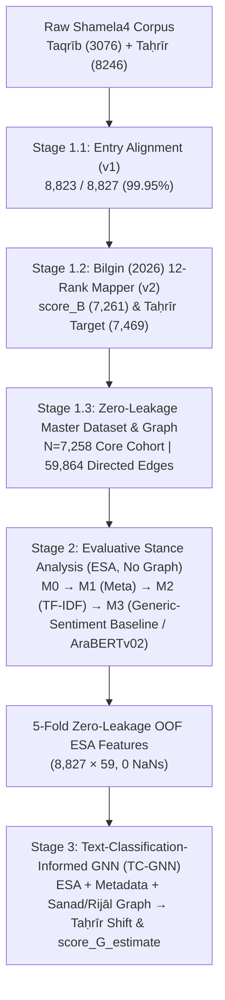

# Stage 1 & Stage 2 Methodology (`taqrib-oriented` v2)

This document specifies the exact implemented methodology, data pipelines, zero-leakage controls, evaluation metrics, and verified empirical outcomes for **Stage 1 (Corpus Alignment, Bilgin-Grounded Target Operationalization & Graph Construction)** and **Stage 2 (Evaluative Stance Analysis [ESA])** on `taqrib-oriented` (v2 frozen) and aligned for `taqrib-oriented-v2` (v3).

---

## 0. Conceptual Architecture: Layered Representation (`Track R`) & Learning (`Track L`)

To preserve classical scholarly integrity while introducing modern computational enrichment, `taqrib-oriented-v2` separates deterministic score layers (`DEC-005`) from learned validation/estimation (`TC-GNN = Text-Classification-informed GNN`, `DEC-006`):

1. **Baseline `B` (`score_B`, formerly Score 1 — `taqrib_rank_bilgin_1_to_12`):** Deterministic operationalization of Ibn Ḥajar al-ʿAsqalānī's 12-rank (*marātib*) taxonomy in *Taqrīb al-Tahdhīb* (`3076`), grounded in **Bilgin (2026, OMÜİFD)**.
2. **Editorial Layer `E₂` (`score_E2`, formerly Score 2 Target — `tahrir_rank_bilgin_1_to_12`):** Scholar-authored critical reassessment extracted from Shaykh Shuʿayb al-Arnāʾūṭ & Dr. Bashshār ʿAwwād Maʿrūf's *Taḥrīr Taqrīb al-Tahdhīb* (`8246`, 1417 AH / 1997 CE), serving as the non-subjective, tradition-grounded target for **Stage 2 (ESA)** and **Stage 3 (TC-GNN)**.
3. **Model Estimate `G` (`score_G_estimate`):** Supplied only where *Taḥrīr* is missing or unmappable (`source = model_estimate`), never overwriting observed scholarly verdicts.

---

## 1. Stage 1: Corpus Alignment, Labeling, Feature Extraction & Graph Linking

### 1.1 *Taqrīb* (`3076`) ↔ *Taḥrīr* (`8246`) Entry Alignment
- **Script:** [extract_tahrir_taqrib_alignment_v1.py](../dataset_discovery/target_feasibility/extract_tahrir_taqrib_alignment_v1.py)
- **Dataset:** [TAHRIR_TAQRIB_ALIGNED_8827_V1.csv](../data/2_interim/rijal_fyp_modelling_pipeline/tahrir_taqrib_alignment_v1_2026-11-20/TAHRIR_TAQRIB_ALIGNED_8827_V1.csv)
- **Extraction Protocol:**
  1. Pages in `8246/pages.jsonl` (`1,754` pages) are sorted into printed book order by `(int(part), int(shamela_page_id))` starting from *Ḥarf al-Alif* (`page_id = 7234541`).
  2. Each entry is segmented by its `•` delimiter per the authors' explicit introduction convention: entries with **no `•` bullet** signify agreement (`agreed_no_bullet`), while entries with `•` contain critical overrides (`• بل:`, `dissent_bal`) or phrase-level qualifications (`• قوله`, `qualification_qawluhu`).
  3. Alignment against `3076` (`ENTRY_INDEX.csv`, `8,827` entries) combines exact entry-number matching with a normalized Arabic name fallback (`4`-word and `3`-word prefixes, normalizing `أ/إ/آ→ا`, `ى→ي`, `ة→ه`, `ابن→بن`, stripping diacritics) to overcome Shamela digitization numbering typos.
- **Coverage (`8,823 / 8,827 = 99.95%`):**
  - `agreed_no_bullet`: **5,766**
  - `dissent_bal` (`• بل:`): **2,621**
  - `other_commentary`: **325**
  - `qualification_qawluhu` (`• قوله`): **111**
  - `unmatched_in_tahrir`: **4** (all audited manually: `E4397`, `E7859`, `E8522`, `E8523`).

### 1.2 Bilgin (2026)-Grounded 12-Rank Operationalization (`v2`)
- **Script:** [build_bilgin_grounded_targets_v2.py](../dataset_discovery/target_feasibility/build_bilgin_grounded_targets_v2.py)
- **Dataset:** [BILGIN_GROUNDED_TAQRIB_TAHRIR_8827_V2.csv](../data/2_interim/rijal_fyp_modelling_pipeline/bilgin_grounded_targets_v2_2026-11-20/BILGIN_GROUNDED_TAQRIB_TAHRIR_8827_V2.csv)
- **Taxonomy Grounding:** Rather than inventing custom rank boundaries, we follow **Bilgin (2026)** (Tables 1–4, pp. 239–243):
  - **Ranks 1–6 (*Taʿdīl*):** `1` *Ṣaḥābah*, `2` *Thiqah thiqah / thabt*, `3` *Thiqah*, `4` *Ṣadūq / lā baʾs bih*, `5` Qualified *ṣadūq* (`صدوق يهم`, etc.), **`6` *Maqbūl*** (`1,581` entries in `v1.4` flagged with `taqrib_is_conditional_maqbul = True`).
  - **Ranks 7–12 (*Jarḥ*):** **`7` *Mastūr / majhūl al-ḥāl / layyin al-ḥadīth / ḍaʿīf yuʿtabaru bih*** (note: per *Taḥrīr*'s introduction p. 45, uncommented `مقبول` in `8246` is explicitly resolved to `ضعيف يعتبر به` = Rank 7), `8` *Ḍaʿīf*, `9` *Majhūl*, `10` *Matrūk / ḍaʿīf jiddan*, `11` *Muttaham bi-l-kadhib*, `12` *Kadhdhāb / waḍḍāʿ*.
- **Target Coverage:**
  - **Score 1 (`taqrib_rank_bilgin_1_to_12`):** **7,261 / 8,827 (82.26%)**
  - **Score 2 Target (`tahrir_rank_bilgin_1_to_12`):** **7,469 / 8,827 (84.61%)** — only `6` non-grade / refuted-companionship-only `dissent_bal` entries remain unmapped (`E0511`, `E1442`, `E1848`, `E3822`, `E4595`, `E5919`).
  - **Core Both-Ranked Cohort (`in_core_cohort_7258 == 1`):** **7,258** entries (`unchanged = 4,498 [61.97%]`, `downgraded = 1,639 [22.58%]`, `upgraded = 1,121 [15.45%]`). The remaining `1,569` entries are intentionally left unranked to preserve zero subjective self-annotation.

### 1.3 Zero-Leakage Master Features, Graph Linking & Splits
- **Script:** [build_taqrib_v2_master_dataset_and_splits.py](../dataset_discovery/target_feasibility/build_taqrib_v2_master_dataset_and_splits.py)
- **Outputs:** [TAQRIB_V2_MASTER_NODES_8827.csv](../data/2_interim/rijal_fyp_modelling_pipeline/taqrib_v2_master_dataset_2026-11-20/TAQRIB_V2_MASTER_NODES_8827.csv) and [TAQRIB_V2_GRAPH_EDGES.csv](../data/2_interim/rijal_fyp_modelling_pipeline/taqrib_v2_master_dataset_2026-11-20/TAQRIB_V2_GRAPH_EDGES.csv)
- **Strict Zero-Leakage Firewall:**
  - Verified `0` occurrences of `تحرير التقريب` or `•` inside `taqrib_text_verbatim` (note: `E2865` contains Ibn Ḥajar's own classical phrase `"هذا تحريره"`).
  - All neighbor baseline aggregations (`nbr_out_*`, `nbr_in_*`) use **only Score 1** (`taqrib_rank_bilgin_1_to_12`), never Score 2.
- **Structured *Taqrīb* Metadata Features (strictly from `3076`):**
  - *Ṭabaqah* (`tabaqa_1_to_12` + `tabaqa_subtier`): **8,544 / 8,827** overall; **99.74%** inside `core_7258` (`19` missing).
  - Canonical & auxiliary sigils (`sigil_bukhari`, `sigil_muslim`, `sigil_abudawud`, `sigil_tirmidhi`, `sigil_nasai`, `sigil_ibnmajah`, `sigil_in_sahihayn`, `sigil_canonical_book_count`, `sigil_has_ayn`, `sigil_has_four`, `sigil_is_tamyiz`, `sigil_has_aux_only`): **8,705 / 8,827** overall; **99.12%** inside `core_7258` (`64` missing).
  - Embedded qualifier flags (`taqrib_has_context_note`, `qual_yudallis`, `qual_yursil`, `qual_yukhti_yahim`, `qual_ikhtalata`, `qual_rumiya_bidah`, `qual_sayyi_hifz`, `qual_lin`, `qual_qalil_hadith`) + `taqrib_char_len` and `taqrib_word_count`.
- **Transmission Graph Connectivity:**
  - **59,864** directed teacher → student edges (`36,994` with both endpoints in `core_7258`; `42,011` pure Sanad/Bukhārī edges).
  - **5,101 / 7,258 (70.28%)** core narrators are non-isolated (`4,776 / 7,258 = 65.80%` via pure Sanad/Bukhārī edges).
  - **Empirical Domain Signal Check (Rank 6 *Maqbūl*):** `graph_out_ge2` is **51.13%** for `upgraded` narrators vs. **26.09%** for `downgraded` narrators, confirming that Sanad out-degree directly captures *Taḥrīr*'s corroboration criterion.
- **Stratified Splits (`seed = 42`):** Disjoint `70 / 15 / 15` splits stratified by `(tahrir_rank_bilgin_1_to_12, shift_class)`: `train = 5,080 (69.99%)`, `val = 1,089 (15.00%)`, `test = 1,089 (15.00%)`, `excluded_unranked = 1,569`.

---

## 2. Stage 2: Evaluative Stance Analysis (ESA) Module

- **Script:** [run_stage2_semantic_benchmarks_v2.py](../experiments/run_stage2_semantic_benchmarks_v2.py)
- **Results:** [STAGE2_RESULTS_SUMMARY_V2.md](../results/stage2_semantic_benchmarks_v2_2026-11-20/STAGE2_RESULTS_SUMMARY_V2.md) & [STAGE2_MODEL_COMPARISON_V2.csv](../results/stage2_semantic_benchmarks_v2_2026-11-20/STAGE2_MODEL_COMPARISON_V2.csv)

### 2.1 Modality Isolation & Dual-Target Formulation
- **Strict Modality Firewall:** Stage 2 uses **only** `taqrib_text_verbatim` and structured *Taqrīb* metadata (`X_meta`). All graph columns (`graph_*`, `sanad_*`, `bukhari_*`, `nbr_*`) and *Taḥrīr* columns are excluded and asserted absent.
- **Dual-Target Formulation:**
  1. **Target A (Ordinal Score 2):** `tahrir_rank_bilgin_1_to_12` (`1–12`).
  2. **Target B (3-Class Evaluative Shift):** `upgraded` / `unchanged` / `downgraded` relative to Score 1.
- **Evaluation Metrics:**
  - *Ordinal:* `rank_mae`, `rank_rmse`, `rank_qwk` (Quadratic Weighted Kappa), `rank_spearman`, `rank_exact_acc`, `rank_within1_acc`.
  - *Wahba et al. (2026) Alignment:* Binary *Taʿdīl* (`1–6`) vs. *Jarḥ* (`7–12`) Accuracy (`bin_acc`), Weighted Precision/Recall/F1 (`bin_weighted_f1`), plus 12-class weighted metrics.
  - *Alturayeif et al. (2024 — StanceEval) Alignment:* 3-class `shift_macro_f1`, `shift_active_macro_f1` ($\frac{1}{2}(\text{F1}_{\text{upgraded}} + \text{F1}_{\text{downgraded}})$), `shift_weighted_f1`.
  - *Rank 6 Subgroup:* `r6_rank_mae`, `r6_rank_exact_acc`, `r6_shift_macro_f1`.

### 2.2 Model Ladder & Name-Stripped Ablation
1. **`M0_Identity_Baseline`:** Predicts Score 1 and `unchanged`.
2. **`M1a–c` (Metadata Only):** Ridge + Balanced Logistic Regression (`M1a`), HistGBDT (`M1b`), Random Forest (`M1c`) on `X_meta` alone.
3. **`M2a–c` (Classical TF-IDF + Metadata):** Word `(1,2)` + Char `(3,5)` TF-IDF + `X_meta` (`M2a` Linear, `M2b` SVD-64 HistGBDT, `M2c` Name-Stripped ablation).
4. **`M3a_CAMeLBERT_Sentiment_Plus_Meta` (Generic-Sentiment Baseline):** Zero-shot GPU polarity probabilities `[p_pos, p_neu, p_neg, polarity]` from `CAMeL-Lab/bert-base-arabic-camelbert-msa-sentiment` + `X_meta` → HistGBDT (weaker than ESA `M3b`, MAE `0.725` vs `0.660`, demonstrating that generic sentiment ≠ evaluative stance).
5. **`M3b_AraBERTv02_Full_DualHead`:** Fine-tuned `aubmindlab/bert-base-arabertv02` (`[CLS]` 768-d) fused with normalized `X_meta` projection (`Linear → LayerNorm → ReLU`), trained with combined loss $\mathcal{L} = \text{CE}_{\text{rank}} + 0.35\,\text{SmoothL1}(\hat{r}_{\text{exp}}, r) + \text{WeightedCE}_{\text{shift}}$ (`5`-fold CV inside `train=5,080`, early stopping on `val` composite `shift_macro_f1 - 0.1 * rank_mae`, `seed=42`).
6. **`M3c_AraBERTv02_NameStripped_DualHead`:** Identical `M3b` architecture trained with narrator names/lineages stripped (`text_name_stripped`), retaining only grade span, context notes, *ṭabaqah*, and sigils.

### 2.3 Verified Test Results (`N = 1,089`)

| Model | Rank MAE ↓ | QWK ↑ | Exact Acc ↑ | Bin Acc (Wahba) ↑ | Shift MF1 (StanceEval) ↑ | Active MF1 ↑ | R6 *Maqbūl* MAE ↓ |
|---|---:|---:|---:|---:|---:|---:|---:|
| `M0_Identity_Baseline` | 0.7181 | 0.8606 | 0.6208 | 0.7998 | 0.2553 | 0.0000 | 1.9694 |
| `M1c_Meta_RandomForest` | 0.7068 | 0.8789 | 0.6208 | 0.8815 | 0.7137 | 0.6273 | 1.5746 |
| `M2b_TFIDF_Full_HistGBDT` | 0.7281 | 0.8848 | 0.6162 | 0.8889 | 0.7058 | 0.6104 | 1.5396 |
| `M3a_CAMeLBERT_Sentiment_Plus_Meta` | 0.7252 | 0.8861 | 0.6070 | 0.8861 | 0.6895 | 0.5886 | 1.5776 |
| **`M3b_AraBERTv02_Full_DualHead`** | **0.6600** | **0.8899** | 0.6364 | 0.8916 | 0.7136 | 0.6208 | 1.5120 |
| **`M3c_AraBERTv02_NameStripped_DualHead`** | 0.6631 | 0.8868 | **0.6382** | **0.9036** | **0.7145** | **0.6277** | **1.4762** |

- **Key Proof (`M3b` vs. `M3c`):** Removing narrator names yields zero degradation (`0.6600` vs. `0.6631` MAE; `M3c` reaches `0.9036` Binary Acc vs. Wahba et al. 2026's `0.8889`), confirming the transformer learns classical evaluative semantics rather than memorizing names.

### 2.4 Zero-Leakage Stage 3 Handoff
- **Artifact:** [STAGE2_OOF_SEMANTIC_FEATURES_8827_V2.csv](../results/stage2_semantic_benchmarks_v2_2026-11-20/STAGE2_OOF_SEMANTIC_FEATURES_8827_V2.csv) (`8,827 × 59` columns, verified `0` NaN/Inf values).
- Inside `train` (`5,080`), predictions and `AraBERTv02` CLS embeddings are strictly **5-fold out-of-fold** (`M2a` + `M3b`); for `val`, `test`, and `excluded_unranked`, features are 5-fold ensembles of the `train`-only models. Columns include `camel_*` (4), `m2_oof_*` (4), `arabert_oof_*` (16), and `arabert_cls_pca_00..31` (32, PCA fitted strictly on `train` CLS embeddings).
